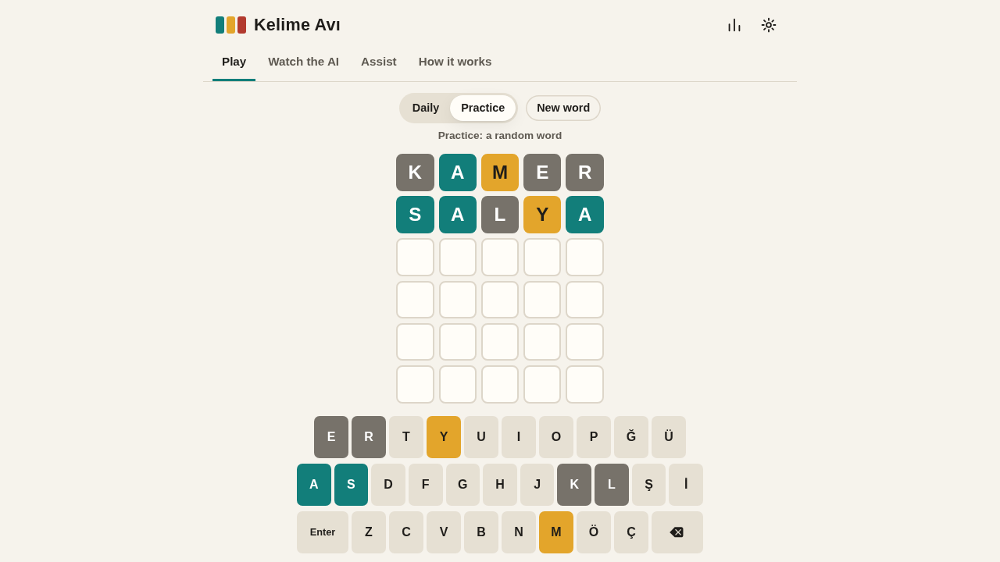

# Turkish Wordle Solver

[](https://github.com/halitberken/turkish-wordle/actions/workflows/tests.yml)

Term project for **BIL 4112 Artificial Intelligence**, Dokuz Eylül University.
Team: Berken (lead), Arda, Faruk.

AI agents that find a hidden 5-letter **Turkish** word in as few guesses as
possible, and a fair, reproducible comparison of them. Word lists are built
from the TDK dictionary and a subtitle frequency list: 5,370 guesses and 1,900
answers, with the Turkish pitfalls (dotted and dotless I, circumflexes,
repeated letters) handled explicitly.

Candidate filtering is done four ways:

* by recomputing the feedback;
* by constraints, provably equivalent to the feedback;
* by a CSP solver (backtracking with forward checking in a trie);
* by a precomputed 10.2 MB pattern table.

The agents range from random and letter-frequency baselines to an entropy
(information-gain) agent with variants and a depth-limited expectimax search.
An exact branch-and-bound oracle serves as the reference. The best agent,
expectimax, needs **3.4095 guesses** on average and never more than 5. That is
the exact optimum for its opener TARİK. Full details are in the
[final report](docs/final_report.md).

**Try it online: [https://halitberken.github.io/turkish-wordle/](https://halitberken.github.io/turkish-wordle/)**. Play Turkish Wordle in the browser
(daily word or practice), watch the AI agents solve any word, or get
suggestions for a game you are playing elsewhere. No install is needed.



## Status

| Week | Topic | Owner | Status |
| --- | --- | --- | --- |
| 6 | Problem definition, Turkish alphabet, word lists, statistics, literature | Faruk | ✅ [doc](docs/week6_problem_and_literature.md) |
| 7 | Feedback, game, agent interface, baselines, evaluation | Arda | ✅ [doc](docs/week7_environment_and_baselines.md) |
| 8 | Constraints, CSP solver, pattern table, filter benchmark | Berken | ✅ [doc](docs/week8_constraints_and_pattern_table.md) |
| 9 | Entropy (information-gain) agent | Arda | ✅ [doc](docs/week9_entropy_agent.md) |
| 10 | Expectimax search and oracle | Berken | ✅ [doc](docs/week10_expectimax_and_oracle.md) |
| 11 | Experiments and analysis | Faruk | ✅ [doc](docs/week11_experiments.md) |
| 12 | Final report, presentation, hand-in | everyone | ✅ [final report](docs/final_report.md), [team roles](docs/team_roles.md) |
| – | Playable web demo (GitHub Pages) | everyone | ✅ [https://halitberken.github.io/turkish-wordle/](https://halitberken.github.io/turkish-wordle/) |

## Setup

Python ≥ 3.10.

```bash
python -m venv .venv
source .venv/bin/activate
pip install -r requirements.txt     # numpy (runtime), matplotlib + pytest (dev)
python -m pytest                    # about 25 s; slow tests are skipped, add --runslow to include them
```

The first run builds the pattern table (about 3 s) and caches it in
`data/cache/`.

## Usage

Every script has `--help`, prints a short summary and writes its outputs to `results/`.

| Command | What it does |
| --- | --- |
| `python scripts/build_word_lists.py` | Builds `data/guesses.txt`, `data/answers.txt`, `data/frequencies.tsv` from `data/raw/`; step counts → `results/word_lists.json` |
| `python scripts/word_stats.py` | Letter frequencies, repeated letters, best openers, one-letter families → `results/word_stats.json`, `results/letter_frequency.png` |
| `python scripts/evaluate.py` | Plays every answer (unlimited guesses; random agents over `--seeds 5`) with the baselines → `results/baselines.json`, `.md`, `results/guess_distribution.png`. Options: `--agent NAME` (repeatable), `--sample N`, `--filter {feedback,constraints,csp,table}`, `--max-guesses N`, `--depth`, `--width`, `--name` |
| `python scripts/evaluate.py --agent random --agent frequency --agent entropy --agent entropy_candidates --agent entropy_freq --agent most_parts --filter table --name entropy_agents` | The week 9 comparison → `results/entropy_agents.json`, `.md`, `results/entropy_agents_guess_distribution.png` |
| `python scripts/benchmark_filters.py --full-check --end-to-end` | Times the four filters on 500 random states, checks that they agree and that every pattern-table cell matches `feedback()`, and times a full evaluation with each filter → `results/filters.json`, `.md` |
| `python scripts/entropy_examples.py` | Best openers by entropy, a worked example, and the hard SA_MA-type words played by every agent → `results/entropy_examples.json`, `.md` |
| `python scripts/expectimax_study.py` | Expectimax cost table (depth × width), small sets and 16 fixed openers against the exact oracle, bounds on the optimum (about 10 minutes) → `results/expectimax.json`, `.md` |
| `python scripts/experiments.py` | Every agent and the ablations on all answers: means with bootstrap 95 % intervals, paired tests, error analysis (about 1 minute) → `results/comparison.json`, `.md` and three charts |
| `python scripts/make_demo.py` | Records the terminal transcripts in `docs/demo/` |
| `python scripts/export_web_data.py` | Exports the word lists, precomputed openers, test fixtures and the results summary for the web demo → `web/public/data/` |
| `python scripts/play.py play` | Play in the terminal (coloured tiles, Turkish keyboard; `--no-color` for emoji) |
| `python scripts/play.py watch --agent expectimax --word sayma` | Watch an agent solve a word turn by turn (agents: `random`, `frequency`, `entropy`, `entropy_candidates`, `entropy_freq`, `most_parts`, `expectimax`) |
| `python scripts/play.py assist` | Suggestions (entropy agent by default) while you play on another site: type your word (Enter = suggestion) and its colours (`g`/`y`/`x`) |

## Web demo

`web/` is a static site in TypeScript and Vite, with no framework. It is deployed to
[GitHub Pages](https://halitberken.github.io/turkish-wordle/) by `.github/workflows/deploy-web.yml` on every push to `main`.
The browser runs faithful ports of the alphabet, feedback, constraints, and the
letter-frequency and entropy agents. The entropy search runs in a Web Worker; the
first two entropy guesses are precomputed in Python.

| Page | What it does |
| --- | --- |
| Play | 6 × 5 board, on-screen Turkish keyboard (all 29 letters), physical keyboard with Turkish İ/ı rules, daily word (the same for everyone) or practice, statistics, shareable emoji grid |
| Watch the AI | The entropy or letter-frequency agent solves a chosen or random word, step by step, with the expected bits and the remaining candidates |
| Assist | Enter the word you tried elsewhere and tap the tiles to set their colours; get the next suggestion, the remaining candidates and the known facts; contradictions are detected |
| How it works | The problem, the methods and the results table |

```bash
python scripts/export_web_data.py     # refresh web/public/data/ (also done in CI)
cd web
npm ci
npm run dev                           # local server with hot reload
npm test                              # Vitest: the TypeScript port against the Python fixtures
npm run build                         # type-check and build web/dist
npx playwright install chromium       # once; or set CHROMIUM_PATH to an installed Chromium
npx playwright test e2e/smoke.spec.ts # smoke test on desktop and 360 px phone sizes
```

Light and dark themes and a colour-blind mode (orange and blue, with shapes) are in
the settings. Statistics and settings are kept in the browser's `localStorage`; the
page still works if storage is blocked. `?word=kalem` starts a practice game with a
given word, which the smoke test uses.

## Results

All 1,900 answers, unlimited guesses, 95 % bootstrap intervals ([`results/comparison.md`](results/comparison.md)):

| Agent | Opener | Mean guesses [95 % CI] | % solved ≤ 6 | Max |
| --- | --- | --- | ---: | ---: |
| random (5 seeds) | – | 4.1126 [4.0887, 4.1368] | 98.38 | 9 |
| letter frequency | ERİKA | 3.7400 [3.6995, 3.7805] | 99.26 | 8 |
| entropy, candidates only | KENAR | 3.5189 [3.4837, 3.5532] | 99.89 | 7 |
| entropy | KAMER | 3.4479 [3.4200, 3.4758] | 100.00 | 5 |
| entropy, frequency prior | KENAR | 3.4479 [3.4200, 3.4747] | 100.00 | 5 |
| most parts | KERİM | 3.4184 [3.3900, 3.4463] | 100.00 | 5 |
| **expectimax (depth 2, width 10)** | TARİK | **3.4095 [3.3832, 3.4363]** | 100.00 | 5 |

* **Optimality.** Expectimax's 3.4095 is the exact optimum for the opener
  TARİK, computed by the oracle ([`results/expectimax.md`](results/expectimax.md)).
  Over all openers, the optimum lies between 2.9242 and 3.4095.
* **Significance.** The steps random → letter frequency → entropy are
  significant (paired permutation test, p = 0.0001). The differences between
  the three search agents are not.
* **Filtering speed** on 500 random states
  ([`results/filters.md`](results/filters.md)), all four methods giving
  identical results:

  | Method | ms per state |
  | --- | ---: |
  | reference | 2.054 |
  | constraints | 0.390 |
  | CSP | 0.502 |
  | pattern table | 0.017 |


## Demo

Web screenshots and terminal transcripts are in [`docs/demo/`](docs/demo/README.md).
Terminal transcripts:
[`watch`](docs/demo/watch.txt), [`play`](docs/demo/play.txt),
[`assist`](docs/demo/assist.txt), the [test run](docs/demo/test_run.txt) and
the [clean-clone check](docs/demo/clean_clone_check.txt). For example:

```text
$ python scripts/play.py watch --agent entropy --word sayma --no-color
entropy agent, hidden word SAYMA, 1,900 candidates
 1. KAMER  ⬜🟩🟨⬜⬜  5.77 bits   51 candidates left
 2. SALYA  🟩🟩⬜🟨🟩  4.10 bits   1 candidate left: SAYMA
 3. SAYMA  🟩🟩🟩🟩🟩  0.00 bits
Solved in 3 guesses.
```

The letter-frequency agent needs 8 guesses for the same word. It tries
SAÇMA, SANMA, SAPMA and SAVMA one by one ([`watch.txt`](docs/demo/watch.txt)).

## Word lists and data

The pipeline counts are in [`results/word_lists.json`](results/word_lists.json).

| List | Words | Definition |
| --- | ---: | --- |
| Guesses `data/guesses.txt` | 5,370 | 5-letter lower-case entries of two TDK dictionary lists (no proper nouns, no multi-word entries, circumflexes removed) |
| Answers `data/answers.txt` | 1,900 | Guesses that also appear in the 50k OpenSubtitles frequency list, minus 7 offensive words (`data/excluded_answers.txt`) |

Data sources (copied into `data/raw/`):
[CanNuhlar/Turkce-Kelime-Listesi](https://github.com/CanNuhlar/Turkce-Kelime-Listesi),
[mertemin/turkish-word-list](https://github.com/mertemin/turkish-word-list),
[hermitdave/FrequencyWords](https://github.com/hermitdave/FrequencyWords) (`content/2018/tr/tr_50k.txt`).

## Repository layout

Owners per week, file and presentation part: [`docs/team_roles.md`](docs/team_roles.md).

```
wordle_tr/                importable package
  alphabet.py               Turkish alphabet, case conversion, normalize, sort_key        (Faruk)
  words.py                  loading, letter encoding, word-list build pipeline            (Faruk)
  stats.py                  word-list statistics                                          (Faruk)
  analysis.py               bootstrap intervals, paired permutation test, buckets         (Faruk)
  feedback.py               feedback(), pattern encoding, emoji, reference filter         (Arda)
  game.py                   WordleGame, InvalidGuessError                                 (Arda)
  simulate.py               play_game, evaluate, summarize, random_histories              (Arda)
  agents/                   Agent interface, registry (make_agent), baselines             (Arda)
    entropy.py              entropy, entropy_candidates, entropy_freq, most_parts         (Arda)
    expectimax.py           depth-limited expectimax with a beam and rollout leaves       (Berken)
  constraints.py            Constraints, ContradictionError, describe()                   (Berken)
  csp_solver.py             WordTrie, CSPSolver (backtracking + forward checking)         (Berken)
  pattern_table.py          vectorised pattern table (cached), partition helpers          (Berken)
  filters.py                the four candidate filters behind one interface               (Berken)
  oracle.py                 exact optimum (Bellman, branch and bound), lower bounds       (Berken)
scripts/                  command-line wrappers (owners as their modules; make_demo.py: everyone)
tests/                    pytest suite, one file per week (owners as above)
data/                     raw sources, word lists, excluded answers, frequencies; cache/ (git-ignored)
results/                  machine-readable results (*.json), tables (*.md), charts (*.png)
docs/                     weekly reports, final report, team roles, demo transcripts and screenshots
web/                      the web demo: src/core (ports), src/app (pages), tests (Vitest), e2e (Playwright)
.github/workflows/        tests.yml: pytest on every push (Python 3.10 and 3.12);
                          deploy-web.yml: export, test, build and deploy the web demo to GitHub Pages
```
