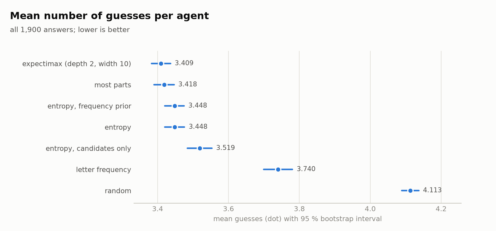

# Turkish Wordle Solver

Term project for **BIL 4112 Artificial Intelligence**, Dokuz Eylül University.
Team: Berken (lead), Arda, Faruk.

AI agents that find a hidden 5-letter **Turkish** word in as few guesses as
possible. The project compares constraint-based candidate filtering (CSP),
information theory (entropy) and expectimax search fairly and reproducibly,
and ends with a playable web demo.

## Status

| Week | Topic | Owner | Status |
| --- | --- | --- | --- |
| 6 | Problem definition, Turkish alphabet, word lists, statistics, literature | Faruk | ✅ done: [doc](docs/week6_problem_and_literature.md) |
| 7 | Feedback, game, agent interface, baselines, evaluation | Arda | ✅ done: [doc](docs/week7_environment_and_baselines.md) |
| 8 | Constraints, CSP solver, pattern table, filter benchmark | Berken | ✅ done: [doc](docs/week8_constraints_and_pattern_table.md) |
| 9 | Entropy (information-gain) agent | Arda | ✅ done: [doc](docs/week9_entropy_agent.md) |
| 10 | Expectimax search and oracle | Berken | ✅ done: [doc](docs/week10_expectimax_and_oracle.md) |
| 11 | Experiments and analysis | Faruk | ✅ done: [doc](docs/week11_experiments.md) |
| 12 | Final report, presentation, hand-in | everyone | ⏳ next |
| – | Playable web demo (GitHub Pages) | – | – |

## Setup

Python ≥ 3.10.

```bash
python -m venv .venv
source .venv/bin/activate
pip install -r requirements.txt     # numpy (runtime), matplotlib + pytest (dev)
python -m pytest                    # slow tests are skipped; add --runslow to include them
```

## Usage

| Command | What it does |
| --- | --- |
| `python scripts/build_word_lists.py` | Builds `data/guesses.txt`, `data/answers.txt`, `data/frequencies.tsv` from `data/raw/`; step counts → `results/word_lists.json` |
| `python scripts/word_stats.py` | Letter frequencies, repeated letters, best openers, one-letter families → `results/word_stats.json`, `results/letter_frequency.png` |
| `python scripts/evaluate.py` | Runs agents on every answer (unlimited guesses; random agents over `--seeds 5`) → `results/baselines.json`, `results/baselines.md`, `results/guess_distribution.png`. Options: `--agent NAME` (repeatable), `--sample N`, `--filter {feedback,constraints,csp,table}`, `--max-guesses N` |
| `python scripts/benchmark_filters.py --full-check --end-to-end` | Times the four filters on 500 random states, checks that they agree and that every pattern-table cell matches `feedback()`, and times a full evaluation with each filter → `results/filters.json`, `results/filters.md` |
| `python scripts/evaluate.py --agent entropy --agent most_parts --filter table --name NAME` | Any registered agents (`random`, `frequency`, `entropy`, `entropy_candidates`, `entropy_freq`, `most_parts`) → `results/NAME.json`, `NAME.md`, `NAME_guess_distribution.png` |
| `python scripts/evaluate.py --agent expectimax --depth 2 --width 10 --filter table --name NAME` | Expectimax agent (search depth and beam width are options) |
| `python scripts/expectimax_study.py` | Expectimax cost table (depth × width), small sets and fixed openers against the exact oracle, bounds on the optimum → `results/expectimax.json`, `.md` |
| `python scripts/experiments.py` | Every agent and the ablations on all answers: means with bootstrap 95 % intervals, paired tests, error analysis → `results/comparison.json`, `.md` and three charts |
| `python scripts/entropy_examples.py` | Best openers by entropy, a worked example, and the hard SA_MA-type words played by every agent → `results/entropy_examples.json`, `.md` |
| `python scripts/play.py play` | Play in the terminal (coloured tiles, Turkish keyboard; `--no-color` for emoji) |
| `python scripts/play.py watch --agent entropy --word kalem` | Watch an agent solve a word turn by turn (entropy agents also show the expected bits) |
| `python scripts/play.py assist` | Suggestions (entropy agent by default) while you play on another site: type your word (Enter = suggestion) and its colours (`g`/`y`/`x`) |

Every script has `--help`.

## Results so far

All 1,900 answers, unlimited guesses, 95 % bootstrap intervals ([`results/comparison.md`](results/comparison.md)):

| Agent | Opener | Mean guesses [95 % CI] | % solved ≤ 6 | Max |
| --- | --- | --- | ---: | ---: |
| random (5 seeds) | – | 4.1126 [4.0887, 4.1368] | 98.38 | 9 |
| letter frequency | ERİKA | 3.7400 [3.6995, 3.7805] | 99.26 | 8 |
| entropy, candidates only | KENAR | 3.5189 [3.4837, 3.5532] | 99.89 | 7 |
| entropy | KAMER | 3.4479 [3.4200, 3.4758] | 100.00 | 5 |
| entropy, frequency prior | KENAR | 3.4479 [3.4200, 3.4747] | 100.00 | 5 |
| most parts | KERİM | 3.4184 [3.3900, 3.4463] | 100.00 | 5 |
| **expectimax (depth 2, width 10)** | TARİK | **3.4095 [3.3832, 3.4363]** | 100.00 | 5 |

Expectimax's 3.4095 is the exact optimum for the opener TARİK, computed by the oracle
([`results/expectimax.md`](results/expectimax.md)); over all openers, the optimum lies between 2.9242 and 3.4095.
The steps random → letter frequency → entropy are significant (paired permutation test, p = 0.0001);
the differences between the three search agents are not (week 11).



Candidate filtering, 500 random states ([`results/filters.md`](results/filters.md)): reference 2.054 ms,
constraints 0.390 ms, CSP 0.502 ms, pattern table 0.017 ms per state, all with identical results.

## Word lists

The pipeline counts are in [`results/word_lists.json`](results/word_lists.json).

| List | Words | Definition |
| --- | ---: | --- |
| Guesses `data/guesses.txt` | 5,370 | 5-letter lower-case entries of two TDK dictionary lists (no proper nouns, no multi-word entries, circumflexes removed) |
| Answers `data/answers.txt` | 1,900 | Guesses that also appear in the 50k OpenSubtitles frequency list, minus 7 offensive words (`data/excluded_answers.txt`) |

Data sources (copied into `data/raw/`):
[CanNuhlar/Turkce-Kelime-Listesi](https://github.com/CanNuhlar/Turkce-Kelime-Listesi),
[mertemin/turkish-word-list](https://github.com/mertemin/turkish-word-list),
[hermitdave/FrequencyWords](https://github.com/hermitdave/FrequencyWords) (`content/2018/tr/tr_50k.txt`).

## Repository layout

```
wordle_tr/       importable package
  alphabet.py      Turkish alphabet, case conversion, normalize, is_valid_word, sort_key   (Faruk)
  words.py         load_guesses / load_answers / encode, word-list build pipeline          (Faruk)
  stats.py         word-list statistics                                                     (Faruk)
  feedback.py      feedback(), pattern encoding, emoji, parse_pattern, reference filter     (Arda)
  game.py          WordleGame, InvalidGuessError                                            (Arda)
  agents/          Agent interface, registry (make_agent), RandomAgent, LetterFrequencyAgent (Arda)
    entropy.py     EntropyAgent: entropy, entropy_candidates, entropy_freq, most_parts      (Arda)
    expectimax.py  ExpectimaxAgent: depth-limited expectimax with a beam, rollout leaves    (Berken)
  oracle.py        exact optimum (Bellman, branch and bound), policy_value, lower bounds    (Berken)
  analysis.py      bootstrap intervals, paired permutation test, difficulty buckets         (Faruk)
  simulate.py      play_game, evaluate, summarize                                           (Arda)
  constraints.py   Constraints, ContradictionError, describe()                              (Berken)
  csp_solver.py    WordTrie, CSPSolver (backtracking + forward checking)                    (Berken)
  pattern_table.py compute_pattern_matrix, PatternTable (cached in data/cache/)             (Berken)
  filters.py       the four candidate filters behind one interface                          (Berken)
scripts/         thin command-line wrappers around the package
tests/           pytest suite
data/            word lists, excluded answers, frequencies, raw sources; cache/ (git-ignored)
results/         machine-readable results (*.json), tables (*.md), charts (*.png)
docs/            weekly reports
```
