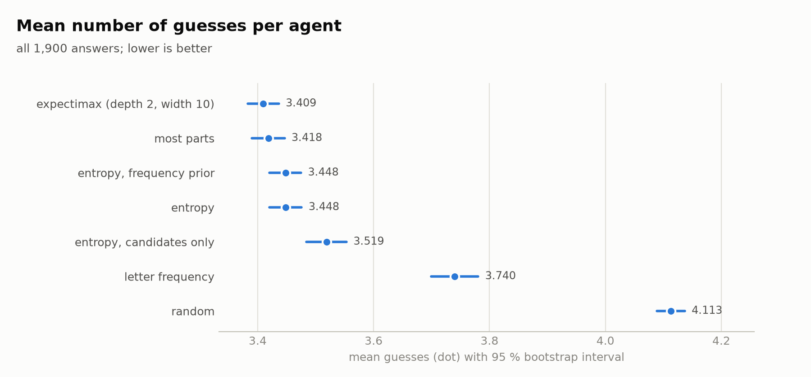
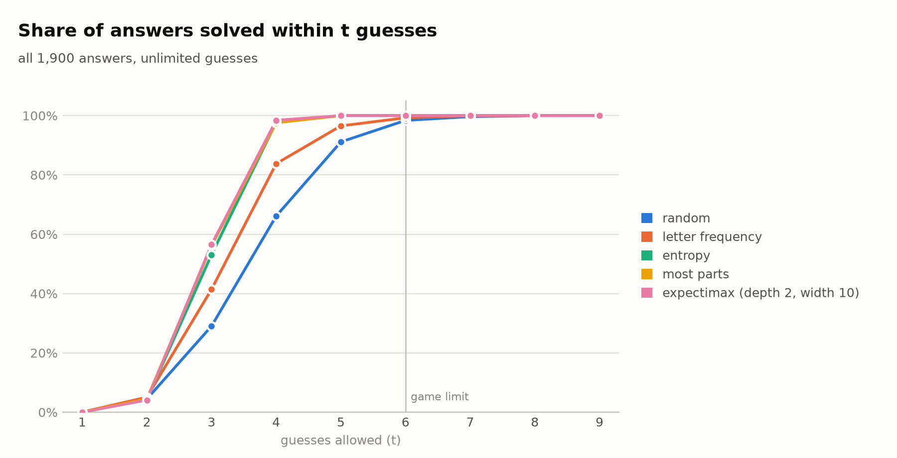

# Solving Turkish Wordle: Constraint Satisfaction, Information Theory and Expectimax Search

*BIL 4112 Artificial Intelligence, Dokuz Eylül University, final report.*
*Team: Berken (lead), Arda, Faruk. November 2026.*

Every number in this report comes from a file in `results/` written by a
script of this repository. The file is named next to each table, and
section 10 lists the commands that regenerate everything.

## Abstract

We build and compare AI agents that find a hidden 5-letter **Turkish** word in
Wordle with as few guesses as possible. The answer list (1,900 common words)
and the guess list (5,370 words) come from the TDK dictionary and a subtitle
frequency list. The data handle Turkish-specific issues: dotted and dotless I,
circumflexes, and 42.47 % of answers containing a repeated letter.

* **Constraint view.** Feedback is turned into constraints that are provably
  equivalent to the feedback rule and solved as a CSP (backtracking with
  forward checking in a trie).
* **Precomputation.** A 10.2 MB table of all 10,203,000 patterns makes the
  search agents fast.
* **Agents.** Five kinds:
  - random and letter-frequency baselines;
  - an entropy (information-gain) agent with three variants;
  - a depth-limited expectimax agent whose leaves are valued by the entropy
    agent (a rollout);
  - an exact branch-and-bound oracle as the reference.
* **Results** (all answers, unlimited guesses):

  | Agent | Mean guesses |
  | --- | ---: |
  | random | 4.1126 |
  | letter frequency | 3.7400 |
  | entropy | 3.4479 |
  | most parts | 3.4184 |
  | expectimax | **3.4095** |

* **Optimality.** For its opener TARİK, expectimax's 3.4095 equals the exact
  optimum. Over all openers, the optimum lies between 2.9242 and 3.4095.
* **Significance.** The gains from random to letter frequency to entropy are
  statistically significant. The differences among the three search agents are
  not.

## 1. Introduction

Wordle is a word-guessing game: after each guess, every letter is coloured
green (right place), yellow (in the word, elsewhere) or grey (not in the word,
or no copies left). The game is a small but complete AI problem:

* a hidden state, the word;
* noisy-looking observations, the patterns, that are in fact deterministic;
* a huge action space, every allowed word;
* an objective under uncertainty, the expected number of guesses.

Solvers for English Wordle are well studied: information theory (Sanderson
2022), exact optimal strategies (Selby 2022; Bertsimas & Paskov 2025),
heuristics (Greenberg 2024), rollout (Bhambri, Bhattacharjee & Bertsekas
2022), and complexity results (Lokshtanov & Subercaseaux 2022). We found no
systematic comparison of solving methods for **Turkish** Wordle. Turkish
differs in ways that matter for solvers:

* a 29-letter alphabet with ı/i, ç, ğ, ö, ş and ü;
* case rules that break standard library functions;
* agglutinative morphology that creates many answers differing in only one
  letter (SAÇMA, SANMA, SAPMA, SAVMA, SAYMA, …).

**Contribution.**

1. A clean, reproducible Turkish word-list pipeline and its statistics.
2. Four interchangeable candidate filters, including a CSP with a proof that
   constraint filtering equals feedback filtering.
3. Entropy, most-parts and expectimax agents evaluated on all answers, with
   confidence intervals and paired tests.
4. Exact optimal values for fixed openers, which show that the expectimax
   agent is optimal for its opener.

## 2. Problem

| Concept | Definition |
| --- | --- |
| Hidden word | s ∈ A, the answer list (1,900 words), uniformly distributed |
| Action | a guess g ∈ G, the guess list (5,370 words), A ⊆ G |
| Observation | the pattern p = f(g, s), one of 3⁵ = 243 |
| Belief state | the candidate set C_t = {w ∈ A : f(g_i, w) = p_i for all i ≤ t}, C_0 = A |
| Objective | minimise the expected number of guesses; secondary: % solved within 6 |

The hidden word is never observed, so this is a partially observable decision
problem. Because the prior is uniform and the feedback deterministic, the
posterior is uniform over C_t, and the **candidate set is a sufficient belief
state**. The minimum expected number of guesses satisfies the Bellman equation

  V*(C) = min_g [ 1 + Σ_{p ≠ all green} (|C_p| / |C|) · V*(C_p) ],   V*({w}) = 1,

with C_p = {w ∈ C : f(g, w) = p}. Deciding whether Wordle can be won within k
guesses is NP-hard (Lokshtanov & Subercaseaux 2022). Exact solutions therefore
need either massive computation or a restricted problem, which motivates the
bounded searches below.

## 3. Data

Two TDK-based word lists (CanNuhlar; mertemin) and the OpenSubtitles 2018 Turkish
50k frequency list (FrequencyWords) were copied into `data/raw/`
(`results/word_lists.json`):

| Step | Words |
| --- | ---: |
| Raw dictionary entries (both lists) | 140,026 |
| Drop proper nouns | 135,048 |
| Drop multi-word or punctuated entries | 106,755 |
| Exactly 5 Turkish letters after normalisation | 10,628 |
| Deduplicate → **guess list** | **5,370** |
| Also in the subtitle top 50k → common words | 1,907 |
| Remove 7 offensive words → **answer list** | **1,900** |

**Turkish-specific handling** (`results/word_stats.json`):

* **Case conversion.** Python's `"İ".lower()` returns two characters and
  `"i".upper()` returns `"I"`, so the project uses its own `to_lower` and
  `to_upper` that map I↔ı and İ↔i.
* **Bad lower-casing in the source.** The subtitle list was lower-cased
  without Turkish rules (it contains `gİzlİ` next to `gizli`). Normalising its
  tokens merges the spellings of 68 answers.
* **Circumflexes** are removed (kâğıt → kağıt). 91 five-letter words had a
  circumflexed spelling.
* **Turkish letters.** 37.00 % of answers contain a letter outside the English
  alphabet.
* **Repeated letters.** 42.47 % of answers contain one, so the feedback rule
  must handle duplicates exactly.
* **One-letter families.** 61.63 % of answers (1,171) differ from another
  answer in exactly one position. The largest family, SA_MA, has 8 members.

## 4. Methods

### 4.1 Environment and feedback

Feedback uses the standard two-pass rule:

1. Mark the greens and collect the answer's unmatched letters.
2. Left to right, a non-green letter is yellow while an unused copy remains,
   otherwise grey.

For example, KAPAK → KALEM gives 🟩🟩⬜⬜⬜, and TATLI → OTLAK gives 🟨🟨⬜🟨⬜.

Patterns are base-3 numbers: grey 0, yellow 1, green 2, with the first letter
as the most significant digit. All green is 242.

In `WordleGame`, invalid guesses do not use a turn, and unlimited mode is used
for all evaluations. The game loop owns candidate filtering. Agents only
implement `choose_guess(history, candidates)`, so filters and agents can be
swapped independently (week 7).

### 4.2 Baselines

* **Random** guesses a uniformly random candidate (seeded).
* **Letter frequency** guesses the candidate whose distinct letters occur in
  the most candidates. Its opener is ERİKA, which is also the best opener by
  letter coverage in week 6.

### 4.3 Constraints, CSP and the pattern table

**Constraints.** An observation (g, p) gives four kinds of constraint:

* fixed letters (green);
* forbidden letters (yellow or grey at that position);
* minimum counts (the green and yellow copies of a letter);
* exact counts (when some copy of the letter is grey).

Several observations combine by the maximum of the minimums and the minimum of
the maximums.

**Theorem** (proved in `docs/week8_constraints_and_pattern_table.md`): for a
pattern p = f(g, s) that can really occur, a word w satisfies the constraints
of (g, p) if and only if f(g, w) = p. The key lemma: the number of green plus
yellow copies of each letter equals min(n_g(L), n_w(L)).

**CSP.** Variables X1..X5 with domains from node consistency, global
letter-count constraints, and a dictionary constraint enforced by searching
inside a **trie** of the answers (4,932 nodes). The search is left-to-right
backtracking with **forward checking**: it prunes when a maximum count would be
exceeded or the required letters no longer fit.

**Pattern table.** M[g, a] = f(g, a) for all 5,370 × 1,900 pairs, computed
with numpy (no Python loop over pairs) using a count form of the yellow rule.
It is stored as `uint8` (10.2 MB) and cached under a hash of the word lists.

### 4.4 Entropy agent

A guess g splits the candidates by pattern. With p_k the share of part k, its
expected information is

  H(g) = −Σ_k p_k log2 p_k.

The agent scores **all 5,370 guesses**, not only candidates, and picks the
largest H. Ties go to candidates, then to Turkish alphabetical order. With at
most 2 candidates left, it guesses a candidate.

Variants:

* `entropy_candidates`: only candidates may be guessed;
* `entropy_freq`: a subtitle-frequency prior, a sigmoid over log-rank;
* `most_parts`: maximise the number of non-empty parts (Greenberg 2024).

The best opener by entropy is KAMER (5.7713 bits, `results/entropy_examples.md`).

### 4.5 Expectimax

Agent nodes choose a guess (minimum over a **beam** of the k best guesses by
entropy); chance nodes weight each pattern by |C_p| / |C|:

  Q_d(C, g) = 1 + Σ_{p ≠ all green} (|C_p| / |C|) · V_{d−1}(C_p),
  V_d(C) = min over the beam of Q_d(C, g)  (1 for |C| = 1, 1.5 for |C| = 2).

**Leaf value.** At depth 0 the leaf value is the **exact expected number of
guesses of the entropy agent**.

**Guarantee.** The entropy agent's choice is always in the beam, so this is a
rollout (Bhambri et al. 2022). By induction, the agent that searches again
every turn satisfies V^π ≤ V_d ≤ … ≤ V_0 = V_entropy for every candidate set.
In expectation it is therefore **never worse than the entropy agent**.

**Speed.** Values are memoised per candidate set and reused across turns and
games. A guess is pruned as soon as its lower bound (2 − 1/s per part of size
s) reaches the best value found. Depth and width are command-line options; the
default is depth 2 and width 10.

### 4.6 Exact oracle

The oracle solves the Bellman equation over all 5,370 guesses by depth-first
branch and bound:

* guesses that split the candidates identically are merged;
* options are ordered by a lower bound;
* exact values and proven lower bounds are memoised.

Two lower bounds make it practical:

* 2 − 1/s for s candidates;
* a one-step bound, 1 + (2n − m(g) − [g is a candidate]) / n, for a guess g
  that splits n candidates into m(g) parts.

The second bound is minimised by the guess with the **most parts**, which
explains why Greenberg's heuristic works well.

## 5. Experiments

**Setup.** Every agent plays all 1,900 answers once, with unlimited guesses and
the pattern-table filter. The random agent plays with 5 seeds, averaged per
word.

* **Confidence intervals** come from a bootstrap over the words (10,000
  resamples, seed 1234).
* **Paired comparisons** use the per-word differences: a bootstrap interval of
  their mean and a sign-flip permutation test (10,000 permutations).

All agents are evaluated on the full answer list, so each mean is the exact
expected value for this list. The intervals describe how the results would
vary on a different sample of similar words.

### 5.1 Filters (`results/filters.md`)

| Method | ms per state (500 random states) | Speed-up |
| --- | ---: | ---: |
| recompute feedback (reference) | 2.054 | 1.0× |
| constraints | 0.390 | 5.3× |
| CSP (trie + forward checking) | 0.502 | 4.1× |
| pattern table | 0.017 | 118.1× |

* **Agreement.** All four filters returned identical candidates on every
  state, and every one of the 10,203,000 table cells equals scalar feedback.
* **CSP pruning.** Forward checking reduces the CSP search from 709.5 to 614.6
  expanded nodes on average.
* **Why the table matters.** One entropy turn over all pairs costs 10.0 s with
  scalar feedback and 38.1 ms with the table.

### 5.2 Agent comparison (`results/comparison.md`)

| Agent | Opener | Mean [95 % CI] | % solved ≤ 6 | Max |
| --- | --- | --- | ---: | ---: |
| random (5 seeds) | ÜZGÜN (seed 0) | 4.1126 [4.0887, 4.1368] | 98.38 | 9 |
| letter frequency | ERİKA | 3.7400 [3.6995, 3.7805] | 99.26 | 8 |
| entropy, candidates only | KENAR | 3.5189 [3.4837, 3.5532] | 99.89 | 7 |
| entropy | KAMER | 3.4479 [3.4200, 3.4758] | 100.00 | 5 |
| entropy, frequency prior | KENAR | 3.4479 [3.4200, 3.4747] | 100.00 | 5 |
| most parts | KERİM | 3.4184 [3.3900, 3.4463] | 100.00 | 5 |
| **expectimax (depth 2, width 10)** | TARİK | **3.4095 [3.3832, 3.4363]** | 100.00 | 5 |





**Paired tests** along the course (positive: the second agent needs fewer
guesses):

| Comparison | Mean difference [95 % CI] | p |
| --- | --- | ---: |
| random → letter frequency | +0.3726 [+0.3317, +0.4133] | 0.0001 |
| letter frequency → entropy | +0.2921 [+0.2505, +0.3342] | 0.0001 |
| entropy → most parts | +0.0295 [−0.0005, +0.0595] | 0.0621 |
| most parts → expectimax | +0.0089 [−0.0237, +0.0416] | 0.6150 |

**Ablations:**

| Question | Mean difference [95 % CI] | p |
| --- | --- | ---: |
| entropy: candidates only → full guess list | +0.0711 [+0.0342, +0.1079] | 0.0002 |
| entropy: frequency prior → uniform | +0.0000 [−0.0311, +0.0311] | 1.0000 |
| expectimax: depth 1 → depth 2 | +0.0005 [−0.0032, +0.0042] | 1.0000 |
| expectimax: depth 2 → depth 3 | +0.0000 [+0.0000, +0.0000] | 1.0000 |
| expectimax: width 10 → width 25 | +0.0000 [+0.0000, +0.0000] | 1.0000 |

### 5.3 Expectimax search cost and the oracle (`results/expectimax.md`)

All configurations with depth ≥ 2 reach 3.4095. Depth 1 reaches 3.4100.

| Depth | Width | Mean guesses | Total s (all 1,900 games) |
| ---: | ---: | ---: | ---: |
| 1 | 10 | 3.4100 | 2.8 |
| 2 | 10 | 3.4095 | 5.1 |
| 2 | 50 | 3.4095 | 37.9 |
| 3 | 50 | 3.4095 | 62.9 |

**Small candidate sets.** On 200 seeded sets of 3–30 words, the optimum
averages 2.0094 guesses:

* expectimax (depth 1, 2 or 3; width 10) is optimal on **all 200**;
* entropy is optimal on 187;
* most parts is optimal on 191.

**Fixed openers.** The exact optimum after an opener can be computed (between
2.6 and 22.3 s per opener). We solved 16 promising openers:

| Opener | Exact optimum | Entropy agent after it | Expectimax after it |
| --- | ---: | ---: | ---: |
| **TARİK** | **3.4095** | 3.4184 | **3.4095** |
| KERİM | 3.4121 | 3.4305 | 3.4142 |
| SERİN | 3.4211 | 3.4295 | 3.4211 |
| KENAR | 3.4342 | 3.4453 | 3.4342 |
| KAMER | 3.4358 | 3.4479 | 3.4363 |

* **Expectimax is optimal for its opener TARİK.** No solved opener beats it.
* **Bounds on the overall optimum.** The one-step bound over all openers gives
  **2.9242 ≤ optimum ≤ 3.4095**. Proving the overall optimum would require
  solving or bounding all 5,370 openers, which we did not attempt.

### 5.4 Error analysis (`results/comparison.md`)

Words grouped by the size of their largest one-letter family (mean guesses):

| Group | Words | letter frequency | entropy | expectimax |
| --- | ---: | ---: | ---: | ---: |
| no neighbour | 729 | 3.5364 | 3.4060 | 3.3663 |
| family of 2 | 764 | 3.7474 | 3.4476 | 3.3914 |
| family of 3–4 | 339 | 3.9587 | 3.4985 | 3.4956 |
| family of 5+ | 68 | 4.7500 | 3.6471 | 3.6471 |

**The baselines lose on families.** 13 of the letter-frequency agent's 14
failures are words with a one-letter neighbour (`results/baselines.json`).
For example, SAYMA takes 8 guesses: SAÇMA, SANMA, SAPMA and SAVMA are tried
one at a time.

**Non-candidate guesses fix this.** The entropy agent solves SAYMA in 3
guesses (KAMER → SALYA → SAYMA). SALYA cannot be the answer, but it tests L
and Y at once (`results/entropy_examples.md`).

**What remains hard for the search agents** are crowded patterns that differ in
two positions, and final 50/50 choices. With expectimax, DAMAK takes 5 guesses:

* six _A_AK words remain after two guesses;
* BAŞÇI cuts them to DALAK and DAMAK;
* the coin flip goes the wrong way.

Only GAZLI and HAVUZ need 5 guesses with all three search agents.

## 6. Discussion

* **Information beats letter counting.** Scoring a guess by how it *splits*
  the candidates, instead of by its letters, saves 0.29 guesses per word
  (letter frequency → entropy) and removes all failures.
* **Non-candidate guesses are what defeats Turkish one-letter families.**
  Restricting entropy to candidates costs 0.0711 guesses per word, which is
  significant, and brings back failures on E_MEK and KA_AR words.
* **Entropy is a proxy; the expected number of guesses is the goal.** Most
  parts minimises a provable lower bound on the expected guesses and beats
  entropy. Expectimax optimises the expectation directly and is optimal for its
  opener. The **opener matters more than the play after it**: after KAMER,
  even perfect play cannot beat 3.4358.
* **Statistics temper the ranking.** On this list the ranking expectimax <
  most parts < entropy is exact. But the gaps (under 0.03 guesses) are within
  the sampling uncertainty of a 1,900-word list, and a different sample of
  answers could reorder them.
* **For comparison,** the optimum for English Wordle is 3.4212 with SALET
  (Selby 2022). Our best Turkish value, 3.4095, is in the same range. The word
  lists, alphabets and list sizes differ, so the numbers are not directly
  comparable.

## 7. Limitations

* **The answer list is our own construction.** It is TDK words that appear in
  a subtitle frequency list, minus 7 offensive words. Other Turkish Wordle
  games use other lists, and results depend on the list.
* **Uniform prior.** Every answer is equally likely in our evaluation, which is
  why a frequency prior cannot help. Real games may favour common words.
* **Global optimum.** It is only bounded, between 2.9242 and 3.4095. The exact
  value with the best opener is known only for the 16 openers we solved.
* **Hard mode** (optional) is not implemented.
* **Implementation.** Everything is pure Python and numpy. Timings are
  machine-dependent, and the CSP is slower than the table because of
  interpreter overhead, not because of its pruning.
* **One evaluation list.** The confidence intervals model word sampling, not
  other sources of variation such as a different guess list.

## 8. Conclusion

Turkish Wordle can be solved almost optimally by combining three course
topics:

* **constraint satisfaction**, for exact candidate filtering;
* **information theory**, to rank guesses;
* **expectimax search with rollout leaves**, to minimise the expected number
  of guesses.

The best agent needs **3.4095 guesses on average**, never more than 5. This
equals the exact optimum for its opener. Turkish-specific issues are handled
explicitly throughout: case rules, circumflexes, duplicate letters and, above
all, one-letter families.

## 9. References

1. G. Sanderson (3Blue1Brown), *Solving Wordle using information theory*, 2022.
   https://www.3blue1brown.com/lessons/wordle
2. A. Selby, *The best strategies for Wordle*, 2022.
   https://sonorouschocolate.com/notes/index.php?title=The_best_strategies_for_Wordle
   (archived copy:
   http://web.archive.org/web/20260822073449/https://sonorouschocolate.com/notes/index.php?title=The_best_strategies_for_Wordle)
3. D. Bertsimas, A. Paskov, *An Exact Solution to Wordle*, Operations Research
   73(3):1384–1394, 2025. https://doi.org/10.1287/opre.2022.0434
4. D. Lokshtanov, B. Subercaseaux, *Wordle Is NP-Hard*, FUN 2022, LIPIcs 226,
   19:1–19:8. https://doi.org/10.4230/LIPIcs.FUN.2022.19
5. S. Bhambri, A. Bhattacharjee, D. Bertsekas, *Reinforcement Learning Methods
   for Wordle: A POMDP/Adaptive Control Approach*, arXiv:2211.10298, 2022.
6. R. I. Greenberg, *Effective Wordle Heuristics*, arXiv:2408.11730, 2024.
7. S. Russell, P. Norvig, *Artificial Intelligence: A Modern Approach*, 4th ed.
   (US), Pearson, 2020: ch. 5 (§5.5 stochastic games), ch. 6 (CSP).
8. Data: github.com/CanNuhlar/Turkce-Kelime-Listesi,
   github.com/mertemin/turkish-word-list, github.com/hermitdave/FrequencyWords
   (`content/2018/tr/tr_50k.txt`).

## 10. Reproduction

```bash
python -m venv .venv && source .venv/bin/activate && pip install -r requirements.txt
python -m pytest                                       # the test suite
python scripts/build_word_lists.py                     # word lists         -> results/word_lists.json
python scripts/word_stats.py                           # statistics         -> results/word_stats.json
python scripts/evaluate.py                             # baselines          -> results/baselines.*
python scripts/benchmark_filters.py --full-check --end-to-end   # filters   -> results/filters.*
python scripts/evaluate.py --agent random --agent frequency --agent entropy --agent entropy_candidates \
    --agent entropy_freq --agent most_parts --filter table --name entropy_agents   # -> results/entropy_agents.*
python scripts/entropy_examples.py                     # openers, examples  -> results/entropy_examples.*
python scripts/expectimax_study.py                     # cost table, oracle -> results/expectimax.*
python scripts/experiments.py                          # comparison         -> results/comparison.*
```

The weekly reports in `docs/` give the details of each part: week 6
(problem, data, literature), week 7 (environment, baselines), week 8
(constraints, proof, CSP, pattern table), week 9 (entropy), week 10
(expectimax, oracle) and week 11 (experiments).
