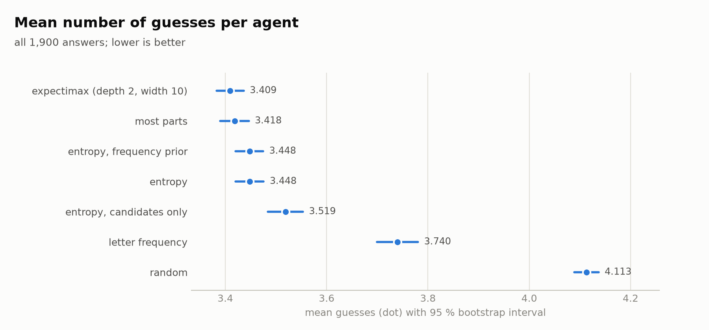
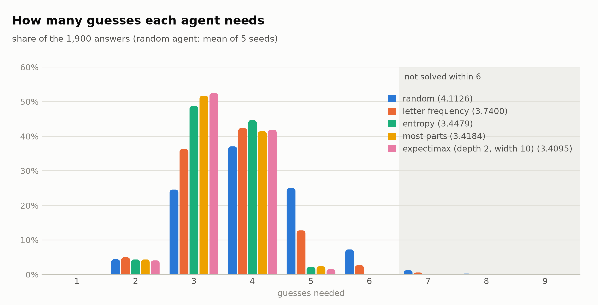
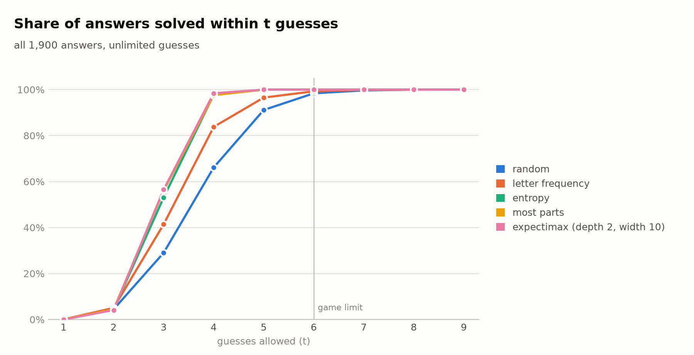

# Week 11: Experiments and analysis

*Owner: Faruk. BIL 4112 Artificial Intelligence, Dokuz Eylül University.*

This week compares all agents of the project under identical conditions, with
confidence intervals and paired tests, runs the ablations, and analyses which
words remain hard and why. Every number below comes from
`results/comparison.md` / `results/comparison.json`, written by:

```bash
python scripts/experiments.py      # about one minute; also writes the three charts below
```

## 1. Setup

* **Conditions.** Every agent plays all **1,900 answers** once, with unlimited
  guesses and the pattern-table filter. The random agent plays 5 times (seeds
  0–4) and its guesses are averaged per word. Every other agent is
  deterministic.
* **Agents.**
  - random and letter frequency (week 7);
  - entropy, entropy over candidates only, entropy with a frequency prior, and
    most parts (week 9);
  - expectimax with depth 2 and width 10 (week 10), plus the configurations
    depth 1, depth 3 and width 25 as ablations.
* **Confidence intervals.** We resample the 1,900 words with replacement 10,000
  times (seed 1234) and take the 2.5 % and 97.5 % percentiles of the mean.
  Every agent and every pair uses the same resamples.
* **Paired comparisons.** All agents play the same words, so for two agents A
  and B we look at the per-word difference d = guesses_A − guesses_B. We report
  its mean with a bootstrap interval, and the p-value of a sign-flip
  permutation test (10,000 permutations). Under "no difference", each d is
  equally likely to be positive or negative. We used this test instead of the
  Wilcoxon signed-rank test because it needs only numpy (no SciPy).
* **How to read the intervals.** Every answer is evaluated, so each mean is the
  *exact* expected number of guesses for a uniformly random hidden word from
  this list. The intervals say how much a mean, or a difference, would move if
  the answer list were a different sample of similar common Turkish words. In
  other words, they say how far the ranking generalises.

## 2. Main results

| Agent | Opener | Mean [95 % CI] | % solved ≤ 6 | Failures (> 6) | Max | ms / guess |
| --- | --- | --- | ---: | ---: | ---: | ---: |
| random (5 seeds) | ÜZGÜN (seed 0) | 4.1126 [4.0887, 4.1368] | 98.38 | 30.8 | 9 | 0.001 |
| letter frequency | ERİKA | 3.7400 [3.6995, 3.7805] | 99.26 | 14 | 8 | 0.055 |
| entropy, candidates only | KENAR | 3.5189 [3.4837, 3.5532] | 99.89 | 2 | 7 | 0.087 |
| entropy | KAMER | 3.4479 [3.4200, 3.4758] | 100.00 | 0 | 5 | 1.088 |
| entropy, frequency prior | KENAR | 3.4479 [3.4200, 3.4747] | 100.00 | 0 | 5 | 1.700 |
| most parts | KERİM | 3.4184 [3.3900, 3.4463] | 100.00 | 0 | 5 | 1.278 |
| **expectimax (depth 2, width 10)** | TARİK | **3.4095 [3.3832, 3.4363]** | 100.00 | 0 | 5 | 0.824 |



Total times for all 1,900 games range from 0.2 s (random) to 11.4 s (entropy
with the frequency prior); expectimax needs 5.5 s (`results/comparison.md`).
Expectimax's time per guess is low because positions are memoised across
games.





| Agent | ≤ 2 | ≤ 3 | ≤ 4 | ≤ 5 | ≤ 6 |
| --- | ---: | ---: | ---: | ---: | ---: |
| random | 4.44 % | 29.02 % | 66.13 % | 91.13 % | 98.38 % |
| letter frequency | 5.05 % | 41.42 % | 83.79 % | 96.53 % | 99.26 % |
| entropy | 4.37 % | 53.11 % | 97.74 % | 100.00 % | 100.00 % |
| most parts | 4.42 % | 56.11 % | 97.58 % | 100.00 % | 100.00 % |
| expectimax | 4.11 % | 56.53 % | 98.42 % | 100.00 % | 100.00 % |

The search agents differ mainly in how many words they finish in **3**
guesses rather than 4. Expectimax solves 56.53 % within 3 and 98.42 % within
4, the most of all agents at both points.

## 3. Paired comparisons along the course

Difference = mean guesses of the first agent minus the second, on the same
words. A positive value means the second agent is better.

| Comparison | Mean difference [95 % CI] | Second better / worse / equal | p |
| --- | --- | --- | ---: |
| random → letter frequency | +0.3726 [+0.3317, +0.4133] | 1205 / 532 / 163 | 0.0001 |
| letter frequency → entropy | +0.2921 [+0.2505, +0.3342] | 727 / 341 / 832 | 0.0001 |
| entropy → most parts | +0.0295 [−0.0005, +0.0595] | 410 / 356 / 1134 | 0.0621 |
| most parts → expectimax | +0.0089 [−0.0237, +0.0416] | 436 / 413 / 1051 | 0.6150 |

* **The first two steps are large and clearly significant.** Letter frequency
  instead of random, and entropy instead of letter frequency, each save about a
  third of a guess per word. Both intervals are far from 0, and p = 0.0001 is
  the smallest value the test can give with 10,000 permutations.
* **The last two steps are small.** Entropy → most parts is borderline: the
  interval touches 0 and p = 0.0621. Most parts → expectimax is not significant
  (p = 0.6150): expectimax is better on 436 words and worse on 413. On this
  answer list, the ranking expectimax < most parts < entropy is exact. Week 10
  showed with the oracle that expectimax is optimal for its opener. But a
  different sample of words could reorder the three search agents. Their
  differences, under 0.04 guesses, are about the size of the uncertainty that
  comes from the word sample.

## 4. Ablations

| Question | Mean difference [95 % CI] | Second better / worse / equal | p |
| --- | --- | --- | ---: |
| Guesses: candidates only → full guess list (entropy) | +0.0711 [+0.0342, +0.1079] | 505 / 410 / 985 | 0.0002 |
| Prior: frequency → uniform (entropy) | +0.0000 [−0.0311, +0.0311] | 369 / 381 / 1150 | 1.0000 |
| Expectimax depth 1 → depth 2 (width 10) | +0.0005 [−0.0032, +0.0042] | 3 / 2 / 1895 | 1.0000 |
| Expectimax depth 2 → depth 3 (width 10) | +0.0000 [+0.0000, +0.0000] | 0 / 0 / 1900 | 1.0000 |
| Expectimax width 10 → width 25 (depth 2) | +0.0000 [+0.0000, +0.0000] | 0 / 0 / 1900 | 1.0000 |

| Expectimax configuration | Mean [95 % CI] | ms / guess | Total s |
| --- | --- | ---: | ---: |
| depth 1, width 10 | 3.4100 [3.3832, 3.4368] | 0.443 | 3.0 |
| depth 2, width 10 | 3.4095 [3.3832, 3.4363] | 0.824 | 5.5 |
| depth 3, width 10 | 3.4095 [3.3832, 3.4363] | 0.935 | 6.2 |
| depth 2, width 25 | 3.4095 [3.3832, 3.4363] | 2.568 | 16.8 |

* **Non-candidate guesses matter, significantly.** Allowing the whole guess
  list saves 0.0711 guesses per word and removes the two failures (week 9).
* **The frequency prior changes nothing on average.** The difference is exactly
  0, although the uniform agent is better on 369 words and worse on 381. This is expected,
  because every answer is played exactly once, so the hidden word *is*
  uniform.
* **Deeper or wider search barely matters.** Depth 2 differs from depth 1 on
  only a handful of words (3 better, 2 worse). Depth 3 and width 25 play exactly the same games
  as depth 2 with width 10. The search has converged: week 10 showed that
  depth 2 is already optimal given the opener TARİK.
* **Hard mode** (an optional item) was not implemented, so there is no hard
  versus normal mode comparison.

## 5. Error analysis

**Which words are hard?** We group the words by the size of their largest
one-letter family (week 6), for example SA_MA with 8 members:

| Group | Words | random | letter frequency | entropy | most parts | expectimax |
| --- | ---: | ---: | ---: | ---: | ---: | ---: |
| no neighbour | 729 | 3.9278 | 3.5364 | 3.4060 | 3.3882 | 3.3663 |
| family of 2 | 764 | 4.1131 | 3.7474 | 3.4476 | 3.3901 | 3.3914 |
| family of 3–4 | 339 | 4.3475 | 3.9587 | 3.4985 | 3.4690 | 3.4956 |
| family of 5+ | 68 | 4.9176 | 4.7500 | 3.6471 | 3.8088 | 3.6471 |

* **For every agent, larger families mean more guesses.** One-letter families
  are the main source of difficulty in Turkish Wordle (weeks 6 and 7).
* **The effect is strongest for the agents that only guess candidates.** The
  letter-frequency agent needs 4.7500 guesses on words in families of 5 or
  more, against 3.5364 on words without a neighbour. For the search agents the
  difference is much smaller (entropy 3.6471 against 3.4060), because they can
  play a non-candidate guess that tests several of the family's letters at once.
* **Most parts is the weakest search agent on the big families** (3.8088). Its
  rule rewards splitting the whole set into many parts, not separating a large
  family.

**Hardest words** (number of guesses, with the word's one-letter family):

* letter frequency: SAYMA 8 (SA_MA), YAZMA 8 (YA_MA), ATMAK 7 (A_MAK), KARAR 7
  (KA_AR), KAZAK 7 (KA_AK), …
* entropy, candidates only: ETMEK 7 (E_MEK), KATAR 7 (KA_AR), ATMAK 6
  (A_MAK), …
* expectimax: CEBİR, DAMAK (DAMA_), DEĞİN (DE_İN), EKMEK (E_MEK), GAZLI,
  GEÇİŞ (GEÇİ_), …, 5 guesses each.

The search agents need at most 5 guesses on any word. Only two words need 5
with entropy, most parts **and** expectimax: **GAZLI** and **HAVUZ**. The
remaining hard words of the search agents are no longer dominated by large
one-letter families. They are words in crowded regions of the list that
differ in two positions, such as _A_AK below, or words that end in a final
50/50 choice.

**An illustrated game: DAMAK.** DAMAK belongs to the family DAMA_ (DAMAK,
DAMAR, DAMAT) and to the crowded pattern _A_AK. Expectimax needs 5 guesses:

```text
1. TARİK ⬜🟩⬜⬜🟩  33 left
2. KIYAS 🟨⬜⬜🟩⬜  6 left: BACAK, BAŞAK, ÇANAK, DALAK, DAMAK, ŞAFAK
3. BAŞÇI ⬜🟩⬜⬜⬜  2 left: DALAK, DAMAK
4. DALAK 🟩🟩⬜🟩🟩  1 left: DAMAK
5. DAMAK 🟩🟩🟩🟩🟩
```

After two guesses six words of the form _A_AK remain. They differ in two
positions at once, and BAŞÇI cuts them down to a pair, DALAK and DAMAK. The last
step is a coin flip, and for DAMAK it went the wrong way. The entropy agent,
with its own opener, happened to reach DAMAK in 3 guesses (KAMER → PAMUK →
DAMAK), and the letter-frequency agent needed 5 guesses. This is the trade-off
behind section 3: expectimax minimises the *average* over all words, so some
individual words are worse than with another agent. Over all words it is
better on 436 words and worse on 413 compared with most parts.

## 6. Conclusions

1. **Information beats heuristics, clearly.** Entropy saves 0.29 guesses per
   word over letter frequency and removes all 14 failures. Both effects are
   significant.
2. **Non-candidate guesses are essential** for one-letter families. Without them
   (candidates only) the mean rises by 0.0711, significantly, and 2 words fail.
3. **Among the search agents, the differences are small.** Expectimax ≤ most
   parts ≤ entropy holds exactly on this list, and expectimax is provably
   optimal for its opener (week 10). The gaps are below the sampling
   uncertainty of a 1,900-word list, so they should not be over-interpreted.
4. **A frequency prior does not help** when the hidden words are uniform over
   the list.
5. **Deeper or wider expectimax search is wasted effort** beyond depth 2 and
   width 10: the opener, not the depth, decides the result.
