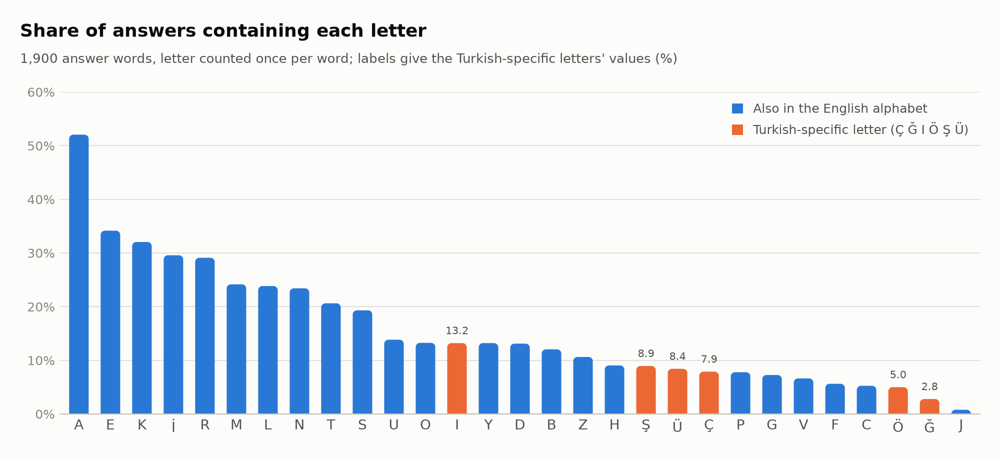

# Week 6: Problem definition, Turkish challenges, data and literature

*Owner: Faruk. BIL 4112 Artificial Intelligence, Dokuz Eylül University.*

Every number in this document comes from `results/word_lists.json` (written by
`scripts/build_word_lists.py`) or `results/word_stats.json` (written by
`scripts/word_stats.py`). To regenerate both:

```bash
python scripts/build_word_lists.py   # data/guesses.txt, answers.txt, frequencies.tsv + results/word_lists.json
python scripts/word_stats.py         # results/word_stats.json + results/letter_frequency.png
```

## 1. Problem definition

The agent has to find a hidden 5-letter Turkish word in at most 6 guesses. After
each guess every letter is coloured:

* **green**: right letter, right position;
* **yellow**: the letter is in the word, but at another position;
* **grey**: the letter is not in the word, or all its copies are already accounted for
  by greens and earlier yellows (the duplicate-letter rule is specified in week 7).

| Concept | Definition |
| --- | --- |
| Hidden word | s ∈ A, A = answer list (1,900 words), assumed uniform |
| Action | guess g ∈ G, G = guess list (5,370 words), A ⊆ G |
| Observation | pattern p = f(g, s), one of 3⁵ = 243 |
| Belief state | candidate set C_t = {w ∈ A : f(g_i, w) = p_i for all i ≤ t}, C_0 = A |
| Transition | C_{t+1} = {w ∈ C_t : f(g_{t+1}, w) = p_{t+1}} |
| Objective | minimise the expected number of guesses; secondary: % solved within 6 |

### A partially observable decision problem

The state (the hidden word) never changes and is never observed directly; the
agent only sees the colour pattern of each guess. This is a POMDP with a
deterministic observation function. Because the prior over A is uniform and
f is deterministic, Bayes' rule gives

P(s | g_1, p_1, …, g_t, p_t) ∝ P(s) · ∏_i 1[f(g_i, s) = p_i],

which is uniform over the words consistent with every observation. The
candidate set C_t is therefore a sufficient statistic for the history: it is the
**belief state**, and the problem becomes a fully observable search over
candidate sets. Let C_{g,p} = {w ∈ C : f(g, w) = p}. The minimum expected
number of guesses still needed from C satisfies the Bellman equation

V(C) = min_{g ∈ G} [ 1 + Σ_{p ≠ all-green} (|C_{g,p}| / |C|) · V(C_{g,p}) ],  V({w}) = 1.

The pattern is all-green only when g ∈ C and g = s, so guessing a candidate
can end the game immediately, while a non-candidate guess may split C better.
That trade-off is what makes the problem interesting.

### Connection to the course

| Course topic | Where it appears in Wordle | Phase |
| --- | --- | --- |
| Constraint satisfaction (week 8) | Each observation (g, p) becomes constraints over the variables X1..X5 (letter domains per position, minimum/exact letter counts) plus a dictionary constraint; C_t is the solution set | Week 8: `Constraints`, `CSPSolver` |
| Probability and information theory (week 9) | The observation distribution P(p \| g, C_t) = \|C_{g,p}\| / \|C_t\|; the expected information of a guess is the entropy of that distribution | Week 9: entropy agent |
| Search with chance nodes, expectimax (week 10) | Agent nodes choose g, chance nodes draw p with the probability above; the value is the expected number of guesses (the Bellman equation above) | Week 10: expectimax agent and oracle |

Solving the Bellman equation exactly over all reachable candidate sets is
infeasible in general: deciding whether Wordle can be won within k guesses is
NP-hard [Lokshtanov & Subercaseaux 2022]. This is why week 10 uses
bounded-depth, beam-limited expectimax and computes the exact optimum only for
small sub-problems.

## 2. Turkish-specific challenges

### Alphabet and letters

The Turkish alphabet has 29 letters, `abcçdefgğhıijklmnoöprsştuüvyz`, with no
q, w or x. Six letters are not in the English alphabet: **ç ğ ı ö ş ü**.
**37.00 %** of the answers (38.94 % of the guesses) contain at least one of
them. Dotted **i** and dotless **ı** are different letters: i appears in
29.58 % of the answers and ı in 13.21 %. Sorting follows the Turkish order
(c < ç < d, ı < i), not Unicode order (`alphabet.sort_key`).



The most common letters (share of answers containing the letter at least once)
are A 52.05 %, E 34.16 %, K 32.05 %, İ 29.58 % and R 29.11 %. The rarest are
J 0.79 % and Ğ 2.79 %.

### Case conversion

Python's default case mapping is wrong for Turkish: `"İ".lower()` returns two
characters (i plus a combining dot), `"I".lower()` returns `"i"` (should be
`"ı"`), and `"i".upper()` returns `"I"` (should be `"İ"`).
`alphabet.to_lower` and `alphabet.to_upper` map I↔ı and İ↔i explicitly before
falling back to the built-in mapping. All words are stored in lower case.

The subtitle frequency list was clearly lower-cased with non-Turkish rules: it
contains tokens such as `İyi` next to `iyi`, and `gİzlİ` next to `gizli`. We
normalise every token, then add up the counts of spellings that become the same
word. **68 answers** get their frequency from more than one spelling (e.g.
`gizli` + `gİzlİ`, `bekar` + `bekâr`). No common word would have been lost
without this step (0 in `word_lists.json`), but its frequency would have been
too low.

### Circumflex

Words written with a circumflex are normalised: â→a, î→i, û→u (kâğıt → kağıt,
hâlâ → hala). Among the 5-letter dictionary entries, **91 distinct words**
have a circumflexed spelling (e.g. âdeta, bekâr, ahkâm). For **19** of them,
the plain spelling is also a dictionary entry (e.g. bekar, dahil, hakim), so
both entries collapse into one word.

### Duplicate letters

**42.47 %** of the answers (41.58 % of the guesses) contain a repeated letter
(e.g. KAPAK, KAYAK, SAÇMA). The feedback function therefore has to implement the
standard two-pass rule exactly (greens first, then yellows left to right, while
unused copies remain). Week 7 specifies and tests the rule.

### One-letter-apart families

Turkish is agglutinative, so the answer list contains many words built from the
same suffix: verbal nouns in *-ma/-me*, infinitives in *-mak/-mek*, the aorist
*-ar*. As a result, many answers differ from another answer in exactly one
position:

* **1,171 answers (61.63 %)** have at least one other answer that differs in a
  single position.
* Family sizes (words sharing four fixed letters): 697 families of 2, 108 of 3,
  27 of 4, 6 of 5, 4 of 6, 1 of 7 and 1 of 8.

| Family | Size | Members |
| --- | ---: | --- |
| SA_MA | 8 | saçma, salma, sanma, sapma, sarma, satma, savma, sayma |
| A_MAK | 7 | açmak, ahmak, almak, anmak, asmak, aşmak, atmak |
| E_MEK | 6 | eğmek, ekmek, emmek, ermek, etmek, ezmek |
| KA_AR | 6 | kaçar, kadar, karar, kaşar, katar, kayar |
| YA_AN | 6 | yaban, yalan, yaman, yaran, yavan, yayan |
| YA_MA | 6 | yağma, yakma, yanma, yapma, yatma, yazma |

These families are the hard cases. Once an agent knows the pattern SA_MA, a guess that
is itself a candidate can only eliminate one of the 8 SA_MA words at a time
(unless it is right). A non-candidate guess containing several of Ç, L, N, P,
R, T, V, Y can split the family at once. This is the main reason the week 9
agents search the full guess list.

### Best openers by distinct-letter coverage

Score of an opener = Σ over its distinct letters of the share of answers that
contain the letter, i.e. the expected number of its letters that come back
green or yellow. Ties are broken in Turkish alphabetical order.

| Rank | Opener (whole guess list) | Expected letters hit | Answers sharing ≥ 1 letter | Opener (answers only) | Expected letters hit | Answers sharing ≥ 1 letter |
| ---: | --- | ---: | ---: | --- | ---: | ---: |
| 1 | ERİKA | 1.7695 | 94.58 % | ERİKA | 1.7695 | 94.58 % |
| 2 | AKEMİ | 1.7200 | 93.47 % | KREMA | 1.7153 | 93.53 % |
| 3 | İKAME | 1.7200 | 93.47 % | MERAK | 1.7153 | 93.53 % |
| 4 | KAİME | 1.7200 | 93.47 % | EKRAN | 1.7079 | 93.68 % |
| 5 | KAMER | 1.7153 | 93.53 % | KENAR | 1.7079 | 93.68 % |
| 6 | KREMA | 1.7153 | 93.53 % | İKRAM | 1.6695 | 91.21 % |
| 7 | MARKE | 1.7153 | 93.53 % | MARKİ | 1.6695 | 91.21 % |
| 8 | MERAK | 1.7153 | 93.53 % | ASKER | 1.6668 | 93.74 % |
| 9 | EKRAN | 1.7079 | 93.68 % | EMLAK | 1.6626 | 93.11 % |
| 10 | ERKAN | 1.7079 | 93.68 % | KALEM | 1.6626 | 93.11 % |

ERİKA ("plum") is also an answer word, so it is the first guess of the week 7
letter-frequency baseline, which only guesses candidates. Letter coverage
ignores letter positions and how the answers split into patterns; the week 9
entropy agent measures that split directly.

## 3. Data pipeline

### Sources

The three raw files were copied into `data/raw/` (option A of the project
specification) and are committed, so the build never needs the network.

| File | Source | Entries | SHA-256 (prefix) |
| --- | --- | ---: | --- |
| `tdk_cannuhlar.txt` | [github.com/CanNuhlar/Turkce-Kelime-Listesi](https://github.com/CanNuhlar/Turkce-Kelime-Listesi) (TDK dictionary) | 76,186 | `3012b7153d1e` |
| `tdk_mertemin.txt` | [github.com/mertemin/turkish-word-list](https://github.com/mertemin/turkish-word-list) (TDK dictionary) | 63,840 | `6e9d4918bee9` |
| `opensubtitles_tr_50k.txt` | [github.com/hermitdave/FrequencyWords](https://github.com/hermitdave/FrequencyWords), `content/2018/tr/tr_50k.txt` | 50,000 | `480192844e7f` |

### Steps and counts

| Step | Words after the step |
| --- | ---: |
| Raw dictionary entries (both lists) | 140,026 |
| Drop proper nouns (entry starts with an upper-case letter, e.g. *Abana*, *Çanakkale*) | 135,048 |
| Drop multi-word or punctuated entries (*aile fotoğrafı*, *Kur'an*, *a / e*) | 106,755 |
| Keep entries that are exactly 5 Turkish letters after normalisation | 10,628 |
| Deduplicate → **guess list** `data/guesses.txt` | **5,370** |
| Keep words that also appear in the 50k subtitle frequency list → common words | 1,907 |
| Remove the hand-curated offensive words in `data/excluded_answers.txt` → **answer list** `data/answers.txt` | **1,900** |

Normalisation means: Unicode NFC, strip surrounding whitespace, Turkish lower
case, remove circumflexes (`alphabet.normalize`). Raw files are split on `\n`
only, because a few multi-word entries such as *ha … ha …* contain the
character U+0085, which Python's `str.splitlines` would treat as a line break.

* **Answers are common words.** The hidden word should be a word people know.
  Appearing among the 50,000 most frequent subtitle tokens is a simple,
  reproducible test for that. Rare dictionary words remain valid guesses.
* **Excluded answers.** `data/excluded_answers.txt` lists 7 common words
  (profanity, sexual content, slurs) that may be guessed but are never chosen as
  the hidden word.
* **Frequencies.** `data/frequencies.tsv` stores `word<TAB>subtitle_count` for
  every answer (merged spellings added up). Week 9 uses it for the frequency
  prior.
* Every output file has a one-line `#` header and is sorted in Turkish
  alphabetical order. `tests/test_alphabet.py` checks that every word is exactly
  5 lower-case Turkish letters, that there are no duplicates, that answers ⊆
  guesses, and that rebuilding from `data/raw/` reproduces the committed files.

## 4. Literature

All links were checked on 2026-11-18.

| Reference | What it contributes | How we use it |
| --- | --- | --- |
| G. Sanderson (3Blue1Brown), *Solving Wordle using information theory*, video and lesson, 6 Feb 2022. [Lesson](https://www.3blue1brown.com/lessons/wordle), [video](https://www.youtube.com/watch?v=v68zYyaEmEA) | Picks the guess with maximum expected information (entropy of the pattern distribution); adds a word-frequency prior | Week 9 entropy agent (`entropy`, `entropy_freq`) |
| A. Selby, *The best strategies for Wordle*, 19 Jan 2022 (updated 2022–2023). [Original URL](https://sonorouschocolate.com/notes/index.php?title=The_best_strategies_for_Wordle), [archived copy](http://web.archive.org/web/20260822073449/https://sonorouschocolate.com/notes/index.php?title=The_best_strategies_for_Wordle) | Exhaustive search for the optimal English strategy: starting with SALET gives an average of 3.4212 guesses (7,920 over 2,315 answers) in normal mode, 3.5084 in hard mode | Reference point for what an optimal strategy achieves; motivates the oracle |
| D. Bertsimas, A. Paskov, *An Exact Solution to Wordle*, Operations Research 73(3):1384–1394, 2025. [doi:10.1287/opre.2022.0434](https://doi.org/10.1287/opre.2022.0434) | Exact dynamic programming (Bellman recursion) over candidate sets; confirms SALET with an average of 3.421 guesses; also covers hard mode and non-uniform priors | Week 10 oracle (Bellman recursion on small sub-problems) |
| D. Lokshtanov, B. Subercaseaux, *Wordle Is NP-Hard*, 11th Int. Conf. on Fun with Algorithms (FUN 2022), LIPIcs 226, 19:1–19:8. [doi:10.4230/LIPIcs.FUN.2022.19](https://doi.org/10.4230/LIPIcs.FUN.2022.19) | Deciding whether a word can be guaranteed within k guesses is NP-hard, and so is approximating the minimum number of guesses | Justifies bounded-depth, beam-limited expectimax instead of exact search on the full list |
| S. Bhambri, A. Bhattacharjee, D. Bertsekas, *Reinforcement Learning Methods for Wordle: A POMDP/Adaptive Control Approach*, arXiv:2211.10298, 2022. [arXiv](https://arxiv.org/abs/2211.10298) | Wordle as a POMDP/adaptive control problem; rollout (one-step lookahead on top of a base heuristic) gives near-optimal play at modest cost | Our POMDP framing (section 1); lookahead in week 10 |
| R. I. Greenberg, *Effective Wordle Heuristics*, arXiv:2408.11730, 2024 (v2 2026). [arXiv](https://arxiv.org/abs/2408.11730) | Compares simple partition heuristics; maximising the number of non-empty bins ("negnumbins"), with ties broken by entropy or expected bin size, works best | Week 9 `most_parts` agent |
| S. Russell, P. Norvig, *Artificial Intelligence: A Modern Approach*, 4th ed. (US), Pearson, 2020: ch. 5 *Adversarial Search and Games* (§5.5 Stochastic Games, expectiminimax) and ch. 6 *Constraint Satisfaction Problems*. [Contents](https://aima.cs.berkeley.edu/contents.html) | Textbook basis for chance nodes / expectiminimax and for CSPs: node consistency, backtracking, forward checking | Weeks 8 and 10. In the Global Edition chapters 5 and 6 are swapped. |

**Gap.** Every reference above studies English Wordle. In November 2026 we
searched for a published comparison of Wordle-solving methods on Turkish and
did not find one. The closest result was a cross-lexicon test on Spanish
(Arafat et al., arXiv:2510.02855, since withdrawn). Turkish Wordle clones exist
as games, but we found no systematic evaluation of solvers on them. Our
contribution is a reproducible comparison of constraint-based filtering,
entropy and expectimax agents on Turkish Wordle, with the Turkish-specific
issues above (alphabet, case conversion, circumflex, duplicate letters,
one-letter families) handled explicitly.

**Verification notes.** At the time of checking, Selby's original URL returned
HTTP 404. The quoted numbers (SALET, 3.4212, 7,920; hard mode 3.5084) were
verified on the Internet Archive snapshot of 22 August 2026 linked above. They
agree with Bertsimas & Paskov (3.421 with SALET). The publisher page of the
Bertsimas & Paskov article could not be fetched (HTTP 403); its bibliographic
data (volume 73, issue 3, pp. 1384–1394, 2025) were confirmed through the
RePEc/IDEAS record.
