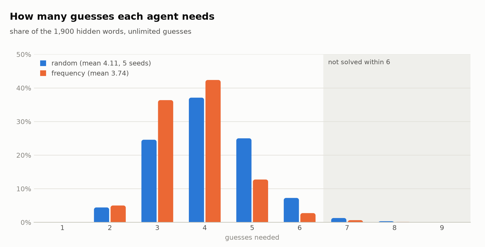

# Week 7: Environment, agent interface and baselines

*Owner: Arda. BIL 4112 Artificial Intelligence, Dokuz Eylül University.*

This week builds the game itself: the feedback function, the pattern
encoding, the game environment and a common interface for agents. It then
evaluates two baseline agents on all 1,900 answers. Every number below comes
from `results/baselines.json` / `results/baselines.md`, written by:

```bash
python scripts/evaluate.py            # random (5 seeds) and frequency, all answers, unlimited guesses
```

## 1. Feedback rule

`feedback(guess, answer)` (`wordle_tr/feedback.py`) implements the standard
two-pass rule:

1. **Greens.** Mark every position where guess and answer agree. Collect the
   answer's letters at the other positions (the *unmatched* letters, with
   multiplicity).
2. **Yellows, left to right.** A non-green guess letter is yellow if an unused
   copy of it is still among the unmatched letters; that copy is consumed.
   Otherwise the letter is grey.

The rule matters because 42.47 % of the answers contain a repeated letter
(week 6). The cases below are all in `tests/test_feedback.py`:

| Guess → answer | Pattern | Why |
| --- | --- | --- |
| KAPAK → KALEM | 🟩🟩⬜⬜⬜ | The second A and the second K are grey: KALEM's only A and K are already matched by greens |
| EKLER → KALEM | ⬜🟨🟩🟩⬜ | The green E (position 4) uses KALEM's only E, so the first E is grey |
| TATLI → OTLAK | 🟨🟨⬜🟨⬜ | OTLAK has one T: the first T takes it (yellow), the second is grey |
| KEKİK → KAYAK | 🟩⬜⬜⬜🟩 | Both K's of KAYAK are matched by greens, so the middle K is grey |
| ALAKA → KAPAK | 🟨⬜🟨🟨⬜ | KAPAK has two A's: the first two (non-green) A's are yellow, the third is grey |
| AAAAA → KAPAK | ⬜🟩⬜🟩⬜ | Two greens use up both A's |
| KALEM → KALEM | 🟩🟩🟩🟩🟩 | All green |
| ÜZGÜN → KALEM | ⬜⬜⬜⬜⬜ | No common letter |

A useful consequence (checked on 5,000 random pairs in the tests and used in
the week 8 proof): for every letter L, the number of green + yellow copies of
L in the feedback equals min(copies of L in the guess, copies of L in the
answer).

## 2. Pattern encoding

A pattern is the base-3 number formed by the five colours, **grey = 0, yellow
= 1, green = 2**, with **position 0 (the first letter) as the most
significant digit**:

pattern = c₀·3⁴ + c₁·3³ + c₂·3² + c₃·3 + c₄ ∈ {0, …, 242}

For example 🟩🟩⬜⬜⬜ = 22000₃ = 2·81 + 2·27 = 216, and all green = 22222₃ =
242 (`ALL_GREEN`). Helpers in `wordle_tr/feedback.py`:

| Function | Purpose |
| --- | --- |
| `encode_colors([2, 2, 0, 0, 0])` → 216 | colours → pattern |
| `decode_pattern(216)` → `[2, 2, 0, 0, 0]` | pattern → colours |
| `pattern_to_emoji(216)` → `🟩🟩⬜⬜⬜` | display |
| `parse_pattern("ggx..")` → 216 | typed input: `g` green, `y` yellow, `x` or `.` grey; emoji also accepted |
| `is_consistent(word, history)` | could `word` be the answer, given all (guess, pattern) pairs? |
| `filter_candidates(candidates, guess, pattern)` | **reference filter**: keep the words w with feedback(guess, w) = pattern |

The encoding is tested in both directions for all 243 patterns.

## 3. The game

`WordleGame(answer, allowed_guesses=None, max_guesses=6)` (`wordle_tr/game.py`):

* `play(guess) -> pattern` scores a guess and appends `(guess, pattern)` to
  `history`. Guesses are normalised with the Turkish rules from week 6, so
  `"KILIÇ"` becomes `kılıç` and `"ERİKA"` becomes `erika`.
* `guesses_used`, `won` (the last pattern is all green) and `over` (won, or
  the limit is reached).
* An invalid guess raises `InvalidGuessError` and **does not use a turn**. A
  guess is invalid if it is not 5 Turkish letters, is not in the allowed
  list, or the game is already over.
* `max_guesses=None` means unlimited guesses. All evaluations use this mode,
  so that the whole distribution is visible, including games that need more
  than 6 guesses. "% solved ≤ 6" is computed from these unlimited runs.

## 4. Agent interface

```python
class Agent(ABC):
    def reset(self) -> None: ...                                         # before every game
    def choose_guess(self, history: History, candidates: list[str]) -> str: ...
# History = list[tuple[str, int]]   (guess, pattern) pairs so far
```

**The game loop owns candidate filtering, not the agent.**
`simulate.play_game(agent, answer, answers, allowed, filter_fn, max_guesses)`
keeps the candidate set C_t (the belief state from week 6). After every guess
it applies `filter_fn(candidates, guess, pattern)`, and it passes the agent a
copy of the history together with the current candidates. Any filter can be
swapped in without touching the agents. `wordle_tr/filters.py` currently
offers the reference filter (`feedback`) and a constraint-based one
(`constraints`). Week 8 adds the CSP and pattern-table filters. All filters
must return the same candidates; the tests check this.

`play_game` records the guesses, the patterns, the number of candidates left
after each guess, and the time spent choosing (agent) and filtering. On the
answer list:

* `evaluate()` plays one game per answer.
* `summarize()` reports the mean number of guesses, the % solved within 6,
  the failures, the maximum, the guess-count histogram, the time per guess
  and the 10 hardest words.

`Constraints` (`wordle_tr/constraints.py`) belongs to week 8. It was written
this week because the `assist` mode below uses its `describe()` to print known
facts in plain English and its consistency checks to detect contradictory
input. The proof that it matches the feedback rule is in the week 8 document.

## 5. Baseline agents

| Name | Agent | Rule |
| --- | --- | --- |
| `random` | `RandomAgent(seed)` | A uniformly random candidate. The random stream is seeded once and continues across games, so a run is reproducible for a given seed. |
| `frequency` | `LetterFrequencyAgent()` | For each candidate w: score(w) = Σ over the *distinct* letters L of w of the number of candidates that contain L. Pick the highest score; ties go to the first word in Turkish alphabetical order. |

Both agents only guess words that are still candidates. The frequency agent's
first guess is **ERİKA**, as in the previous build. It is the same in every
game, so the agent caches it.

## 6. Results

All 1,900 answers, unlimited guesses, reference filter. The random agent is
run with seeds 0–4; its numbers are the mean ± sample standard deviation over
the five runs.

| Agent | Runs | First guess | Mean guesses | % solved ≤ 6 | Failures (> 6) | Max |
| --- | ---: | --- | ---: | ---: | ---: | ---: |
| random | 5 seeds | ÜZGÜN (seed 0) | 4.1126 ± 0.0352 | 98.38 ± 0.21 | 30.8 | 9 |
| frequency | 1 | ERİKA | **3.7400** | **99.26** | 14 | 8 |



| Guesses | random (mean of 5 seeds) | frequency |
| ---: | ---: | ---: |
| 1 | 0.4 | 1 |
| 2 | 84.0 | 95 |
| 3 | 467.0 | 691 |
| 4 | 705.0 | 805 |
| 5 | 475.0 | 242 |
| 6 | 137.8 | 52 |
| 7 | 24.2 | 12 |
| 8 | 6.0 | 2 |
| 9 | 0.6 | 0 |

**Comparison with the previous build.** The reference values were random
≈ 4.11 ± 0.01 (≈ 98.3 % within 6) and letter frequency ≈ 3.74 (≈ 99.3 %,
worst 8). The frequency agent matches exactly: 3.7400, 99.26 %, worst 8. The
random agent's mean (4.1126) and solve rate (98.38 %) also match. The spread
is larger: the five per-seed means range from 4.0668 to 4.1537, a sample
standard deviation of 0.0352. The reference ± 0.01 probably used different
seeds or a different statistic (for example the standard error); we cannot
tell from the specification.

**Speed** (machine-dependent): the frequency agent needs 0.050 ms per
decision. The reference filter needs about 0.5 ms per guess on average; most
filtering happens on small candidate sets after the first guess. A full
1,900-game evaluation takes about 4 seconds per agent.

## 7. Error analysis: the 14 games the frequency agent loses

The frequency agent solves all but 14 of the 1,900 words within 6 guesses.
Those 14 need 7 or 8 guesses (full table in `results/baselines.md`):

| Answer | Guesses | One-letter family (week 6) |
| --- | ---: | --- |
| SAYMA | 8 | SA_MA (8 words) |
| YAZMA | 8 | YA_MA (6 words) |
| ATMAK | 7 | A_MAK (7 words) |
| CENİN | 7 | none (but see below) |
| KARAR | 7 | KA_AR (6 words) |
| KAZAK | 7 | KA_AK (5 words) |
| KISIK | 7 | KISI_ (3 words) |
| KUŞAK | 7 | KU_AK (4 words) |
| KÜTÜK | 7 | KÜ_ÜK (2 words) |
| SAVMA | 7 | SA_MA (8 words) |
| TATLI | 7 | _ATLI (2 words) |
| TERZİ | 7 | TER_İ (3 words) |
| YAPMA | 7 | YA_MA (6 words) |
| ZARAR | 7 | _ARAR (3 words) |

**13 of the 14 failures** are answers that have another answer one letter
away. The largest families from week 6 dominate: SA_MA (SAYMA, SAVMA), YA_MA
(YAZMA, YAPMA), A_MAK, KA_AR, KA_AK. The 14th, CENİN, belongs to a family
that differs in two positions: the agent tries BESİN, DEFİN, ÇETİN and PEŞİN,
all of the form _E_İN.

The SAYMA game shows the mechanism (`python scripts/play.py watch --agent
frequency --word sayma`):

```text
 1. ERİKA  ⬜⬜⬜⬜🟩   84 candidates left
 2. DOLMA  ⬜⬜⬜🟩🟩   20 candidates left
 3. SITMA  🟩⬜⬜🟩🟩   5 candidates left: SAÇMA, SANMA, SAPMA, SAVMA, SAYMA
 4. SAÇMA  🟩🟩⬜🟩🟩   4 candidates left: SANMA, SAPMA, SAVMA, SAYMA
 5. SANMA  🟩🟩⬜🟩🟩   3 candidates left: SAPMA, SAVMA, SAYMA
 6. SAPMA  🟩🟩⬜🟩🟩   2 candidates left: SAVMA, SAYMA
 7. SAVMA  🟩🟩⬜🟩🟩   1 candidate left: SAYMA
 8. SAYMA  🟩🟩🟩🟩🟩
```

After three guesses only five words remain, and they differ in a single
position (Ç, N, P, V, Y as letter 3). Every remaining candidate shares the
other four letters, so guessing one of them can only answer "is it this
word?". Each guess removes exactly one candidate (5 → 4 → 3 → 2 → 1). In
general, a family of k words that differ in one position can cost k
guesses.

### Why guessing only candidates causes this

Both baselines only ever guess words that are still possible. That is
sensible when the candidates are very different, because the guess might be
right. Inside a one-letter family it is the worst choice: the shared letters
are already known, so a candidate tests only one new letter. A **non-candidate**
guess can test several of the open letters at once. In the SAYMA game above,
a word containing several of Ç, N, P, V and Y would split the five remaining
candidates into different patterns with a single guess. The cost is that such a guess can never
win immediately. Weighing this trade-off requires measuring how well a guess
splits the candidates, over the **whole guess list**. That is exactly what
the entropy agent of week 9 does.

## 8. Terminal tools

`scripts/play.py` has three modes (all support `--no-color`, which prints
emoji instead of ANSI colours):

* `play`: you guess a hidden answer in 6 tries, with coloured tiles and a
  Turkish Q keyboard showing the best known colour of every letter. Invalid
  words are rejected without using a turn. A win prints a shareable emoji
  grid. `--word` fixes the word; `--seed` replays a random one.
* `watch --agent frequency --word kalem`: an agent solves a word; every turn
  shows the guess, its pattern and the remaining candidates (listed when at
  most `--show` remain).
* `assist`: help while you play on another site. The agent suggests a word;
  you type the word you actually tried (Enter = the suggestion) and its
  colours (`g`/`y`/`x` or emoji). The tool shows the remaining candidates and
  the known facts from `Constraints.describe()`, for example
  `Letter 4 is M; letter 5 is A; not in word: D, E, İ, K, L, O, R`. It
  rejects contradictory input, either impossible patterns or patterns that
  conflict with earlier turns or leave no answer, and asks for that turn
  again.

## 9. Tests

`tests/test_feedback.py`, `tests/test_game.py` and `tests/test_agents.py`
cover:

* the duplicate-letter cases above;
* encoding round-trips;
* `parse_pattern`;
* the filter always keeping the true answer on 300 random histories (seed 1234);
* the game rules: win in two, end after six, invalid guesses not using a turn,
  unlimited mode;
* both agents solving a sample of 100 answers;
* determinism and seed reproducibility;
* the `summarize` fields;
* smoke tests of the three `play.py` modes.
