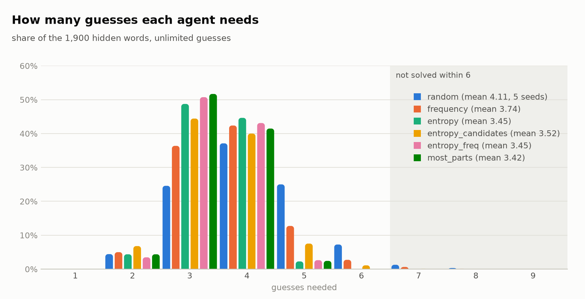

# Week 9: Entropy (information-gain) agent

*Owner: Arda. BIL 4112 Artificial Intelligence, Dokuz Eylül University.*

Week 7 showed that agents which only guess candidates lose on one-letter
families such as SA_MA. This week adds an agent that measures how much
information a guess gives, using probability and information theory, and
searches the **whole guess list** for the best one.

Every number below comes from `results/entropy_agents.md` / `.json` and
`results/entropy_examples.md` / `.json`, written by:

```bash
python scripts/evaluate.py --agent random --agent frequency --agent entropy --agent entropy_candidates \
    --agent entropy_freq --agent most_parts --filter table --name entropy_agents
python scripts/entropy_examples.py
```

## 1. Expected information of a guess

Let C be the current candidate set (the belief state, week 6). A guess g
splits C into parts by the pattern each candidate would produce:
C_{g,k} = {w ∈ C : f(g, w) = k}. Under the uniform prior, pattern k appears
with probability p_k = |C_{g,k}| / |C|. Seeing it gives −log2 p_k bits of
information, because it shrinks the candidate set by that factor. The
**expected information** of g is the entropy of the pattern distribution:

  H(g) = − Σ_k p_k · log2 p_k   (bits)

Equivalently, H(g) = Σ_k p_k (log2 |C| − log2 |C_{g,k}|). It is the expected
drop in log2 of the number of candidates. A guess is good if it splits the
candidates into many small parts. H is at most log2 |C|, reached when every
candidate gives a different pattern, and at most log2 243 = 7.92 bits, because
there are only 243 patterns.

**The agent** (`wordle_tr/agents/entropy.py`, registered as `entropy`):

1. With at most 2 candidates left, guess a candidate. Otherwise score
   **every one of the 5,370 allowed guesses**, not only the candidates.
2. Pick the guess with the largest H. Ties go to a guess that is itself a
   candidate (it might win right away), then to the first word in Turkish
   alphabetical order.
3. The opening position is the same in every game, so the first guess is
   computed once and cached.

**Implementation.** The agent receives the week 8 `PatternTable` when it is
built; the agent interface is unchanged. For the candidate ids it takes the
table columns `M[:, ids]` (all guesses × candidates) and sorts each row, so
that equal patterns form runs. Each run is one part, and its length is the
part size c. Then H = log2 n − (Σ c log2 c) / n for all 5,370 guesses at once,
in numpy. The weighted version used by the prior variant sums the prior
weights of each run instead. On the full evaluation the entropy agent needs
0.888 ms per decision (`results/entropy_agents.md`).

## 2. Worked example

In the week 7 SAYMA game, the letter-frequency agent reached this position
after ERİKA ⬜⬜⬜⬜🟩, DOLMA ⬜⬜⬜🟩🟩, SITMA 🟩⬜⬜🟩🟩. Five candidates are left:
SAÇMA, SANMA, SAPMA, SAVMA, SAYMA. Two possible next guesses:

**SAÇMA** (a candidate; the letter-frequency agent's choice):

| Pattern | Candidates | p_k |
| --- | --- | ---: |
| 🟩🟩⬜🟩🟩 | SANMA, SAPMA, SAVMA, SAYMA | 4/5 |
| 🟩🟩🟩🟩🟩 | SAÇMA | 1/5 |

H(SAÇMA) = −(4/5 · log2 4/5 + 1/5 · log2 1/5) = **0.7219 bits**.

**AVUNÇ** (not a candidate; the entropy agent's choice for this position):

| Pattern | Candidates | p_k |
| --- | --- | ---: |
| 🟨⬜⬜⬜⬜ | SAPMA, SAYMA | 2/5 |
| 🟨⬜⬜⬜🟨 | SAÇMA | 1/5 |
| 🟨⬜⬜🟨⬜ | SANMA | 1/5 |
| 🟨🟨⬜⬜⬜ | SAVMA | 1/5 |

H(AVUNÇ) = −(2/5 · log2 2/5 + 3 · 1/5 · log2 1/5) = **1.9219 bits**.

AVUNÇ cannot be the answer, but it tests V, N and Ç at once. Each candidate
guess can only ask "is it this word?". After AVUNÇ at most two words remain,
so the game ends at most two guesses later. Guessing candidates one by one
can take five more guesses, as it did in week 7. No allowed guess separates
all five: the best one, AVUNÇ, reaches 1.9219 bits, below log2 5 = 2.3219.

## 3. Best openers

With all 1,900 answers as candidates (`results/entropy_examples.md`):

| Rank | Guess | Entropy (bits) | Parts | Is an answer |
| ---: | --- | ---: | ---: | --- |
| 1 | KAMER | 5.7713 | 139 | no |
| 2 | TARİK | 5.7669 | 133 | no |
| 3 | KENAR | 5.7571 | 130 | yes |
| 4 | MERAK | 5.7428 | 134 | yes |
| 5 | KAMİL | 5.6931 | 139 | yes |
| 6 | KELAM | 5.6923 | 135 | no |
| 7 | KARNİ | 5.6883 | 126 | no |
| 8 | KALEM | 5.6871 | 134 | yes |
| 9 | MALİK | 5.6856 | 131 | yes |
| 10 | SERAK | 5.6855 | 132 | no |

The best opener, **KAMER**, gives 5.7713 bits: on average the 1,900
candidates shrink by that many halvings. It is a valid guess but not an
answer, so the entropy agent never wins in one guess. The common letters K,
A, M, E and R (week 6) dominate the list, as with the letter-coverage
openers, but entropy also rewards letters in good *positions*.

## 4. Variants

All variants share the code above. Each is a constructor option and a
registered agent name.

| Name | Change | Opener |
| --- | --- | --- |
| `entropy` | uniform prior, full guess list | KAMER, 5.7713 bits |
| `entropy_candidates` | only candidates may be guessed (isolates the effect of non-candidate guesses) | KENAR, 5.7571 bits |
| `entropy_freq` | prior weighted by subtitle frequency | KENAR, 5.7574 bits |
| `most_parts` | maximise the number of non-empty parts (Greenberg's "most bins"); ties by entropy, then candidate, then Turkish order | KERİM, 143 parts |

**Frequency prior.** The answers are ranked by their subtitle count
(`data/frequencies.tsv`, rank 1 = most frequent). Each gets the weight
w = 1 / (1 + exp((ln rank − ln 950) / 0.5)), a sigmoid over the log-rank
centred at half the list. Frequent words get almost 1 and the rarest
answers much less. Pattern probabilities become weighted shares,
P_k = Σ_{s ∈ C_k} w_s / Σ_{s ∈ C} w_s, and H uses them. With two candidates
left, it guesses the more probable one.

## 5. Results

All 1,900 answers, unlimited guesses, pattern-table filter
(`results/entropy_agents.md`):

| Agent | First guess | Mean guesses | % solved ≤ 6 | Failures (> 6) | Max | Agent ms / guess |
| --- | --- | ---: | ---: | ---: | ---: | ---: |
| random (5 seeds) | ÜZGÜN (seed 0) | 4.1126 ± 0.0352 | 98.38 ± 0.21 | 30.8 | 9 | 0.001 |
| frequency | ERİKA | 3.7400 | 99.26 | 14 | 8 | 0.048 |
| **entropy** | KAMER | **3.4479** | **100.00** | **0** | **5** | 0.888 |
| entropy_candidates | KENAR | 3.5189 | 99.89 | 2 | 7 | 0.075 |
| entropy_freq | KENAR | 3.4479 | 100.00 | 0 | 5 | 1.448 |
| most_parts | KERİM | **3.4184** | 100.00 | 0 | 5 | 1.100 |



* **Entropy clearly beats the baselines.** The mean drops from 3.7400 to
  3.4479. Every word is solved within 5 guesses, so there are no failures
  instead of 14. The full evaluation takes 5.93 s of agent and filter time
  (`total_time_s` in `results/entropy_agents.json`), well under the one-minute
  target.
* **Non-candidate guesses matter.** Restricted to candidates, the same rule
  gets 3.5189 and loses 2 words in 7 guesses: ETMEK (family E_MEK) and KATAR
  (family KA_AR). These are the same one-letter-family failures as in week 7.
* **The frequency prior does not help here.** `entropy_freq` reaches the same
  mean (3.4479) with a different distribution: 66 games in 2 guesses instead
  of 83, and 964 in 3 instead of 926. This is expected: our evaluation plays
  every answer exactly once, so the hidden word *is* uniform. A prior only pays
  off when the real answers favour frequent words.
* **Most parts is best.** Maximising the number of parts gives 3.4184, better
  than maximising entropy. This matches Greenberg (2024). Entropy is a greedy
  one-step criterion, not the expected number of guesses, so it is not optimal.
  Week 10 optimises that quantity directly.

## 6. How the SA_MA family is handled now

The SAYMA game played by each agent (`results/entropy_examples.md`):

```text
frequency (8 guesses)                    entropy (3 guesses)
1. ERİKA ⬜⬜⬜⬜🟩  84 left               1. KAMER ⬜🟩🟨⬜⬜  5.77 bits  51 left
2. DOLMA ⬜⬜⬜🟩🟩  20 left               2. SALYA 🟩🟩⬜🟨🟩  4.10 bits  1 left: SAYMA
3. SITMA 🟩⬜⬜🟩🟩  5 left               3. SAYMA 🟩🟩🟩🟩🟩
4. SAÇMA 🟩🟩⬜🟩🟩  4 left
5. SANMA 🟩🟩⬜🟩🟩  3 left
6. SAPMA 🟩🟩⬜🟩🟩  2 left
7. SAVMA 🟩🟩⬜🟩🟩  1 left: SAYMA
8. SAYMA 🟩🟩🟩🟩🟩
```

After KAMER (A second, M in the word but not third), 51 candidates are left.
The entropy agent then plays **SALYA**. It contains no M, so it cannot be the
answer, but it places S, A and A and tests L and Y in one guess. Only SAYMA
fits the result.

The 14 words the letter-frequency agent needs more than 6 guesses for, played
by every agent (number of guesses):

| Word | frequency | entropy | entropy_candidates | entropy_freq | most_parts |
| --- | ---: | ---: | ---: | ---: | ---: |
| ATMAK | 7 | 3 | 6 | 3 | 3 |
| CENİN | 7 | 4 | 3 | 4 | 4 |
| KARAR | 7 | 4 | 5 | 3 | 3 |
| KAZAK | 7 | 4 | 6 | 4 | 5 |
| KISIK | 7 | 4 | 3 | 4 | 3 |
| KUŞAK | 7 | 4 | 5 | 4 | 4 |
| KÜTÜK | 7 | 3 | 3 | 3 | 4 |
| SAVMA | 7 | 4 | 5 | 4 | 5 |
| SAYMA | 8 | 3 | 6 | 5 | 4 |
| TATLI | 7 | 5 | 4 | 4 | 5 |
| TERZİ | 7 | 4 | 5 | 5 | 4 |
| YAPMA | 7 | 4 | 4 | 4 | 4 |
| YAZMA | 8 | 5 | 5 | 4 | 4 |
| ZARAR | 7 | 4 | 3 | 4 | 5 |
| **max** | 8 | 5 | 6 | 5 | 5 |

Every agent that may guess non-candidates solves all of them within 5. The
candidates-only variant still needs up to 6.

## 7. Tests

`tests/test_entropy.py` checks:

* entropies of known partitions;
* the vectorised scores against scalar feedback (uniform and weighted);
* every variant returns an allowed word (a candidate when required);
* the tie-break: with KALEM, KALIN and KAYAK left, KALEM is chosen over
  non-candidates such as ABACI that split them just as well;
* the two-candidate rule;
* the cached opener;
* the frequency prior;
* determinism;
* that `entropy` solves every answer, and that its mean is not worse than the
  letter-frequency agent's on the full list.

The terminal tools now show the expected bits:
`python scripts/play.py watch --word sayma` (entropy is the default agent in
`watch` and `assist`).
